# WolfGPT

<details>
<summary><b>Português</b> (clique para abrir / click to open)</summary>

<br>

Um GPT pequeno (110 milhões de parâmetros) construído, treinado e ajustado **do zero** numa única placa de vídeo comum (RTX 5060 Ti, 16 GB), com cada passo documentado. O objetivo era aprender como os modelos de linguagem realmente funcionam construindo um de ponta a ponta: ambiente, um GPT minúsculo à mão, dados e tokenizer, experimentos com otimizadores, um pré-treino de 3 bilhões de tokens, ajuste fino para chat, benchmarks e publicação.

> O modelo final é publicado como **Llama-WolfGPT-110M** (Hugging Face: [explorerkiil/Llama-WolfGPT-110M](https://huggingface.co/explorerkiil/Llama-WolfGPT-110M)). É um projeto de aprendizado e uma demonstração de conversa, não um assistente confiável.

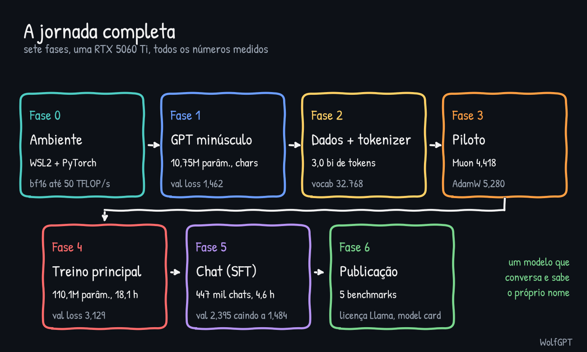

[O que saiu disso](#o-que-saiu-disso) · [O modelo](#o-modelo) · [A jornada, fase por fase](#a-jornada-fase-por-fase) · [O que eu aprendi](#o-que-eu-aprendi) · [Decisões finais](#decisões-finais) · [Glossário](#glossário) · [Mapa do repositório](#mapa-do-repositório) · [Reproduzindo (resumo)](#reproduzindo-resumo) · [Licenças e dados](#licenças-e-dados) · [Agradecimentos](#agradecimentos)

## O que saiu disso

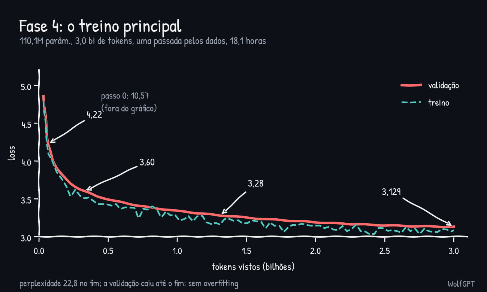

| Etapa | Resultado |
|---|---|
| Pré-treino (amostra do FineWeb-Edu, 3,0 bi de tokens, 18,1 h) | loss de validação 3,129 (perplexidade cerca de 22,8) |
| Ajuste fino para chat (SFT, 446 mil conversas, 267M tokens, 4,6 h) | loss de validação de 2,395 para 1,484 |
| Fase de identidade (300 conversas escritas à mão) | responde "I'm WolfGPT... built by Explorer" |


Acima do acaso em HellaSwag, ARC-Easy e PIQA; no acaso nos testes que exigem raciocínio de verdade. Os fatos costumam estar errados, a aritmética é pouco confiável e ele inventa histórias quando alguém faz teatro com ele.

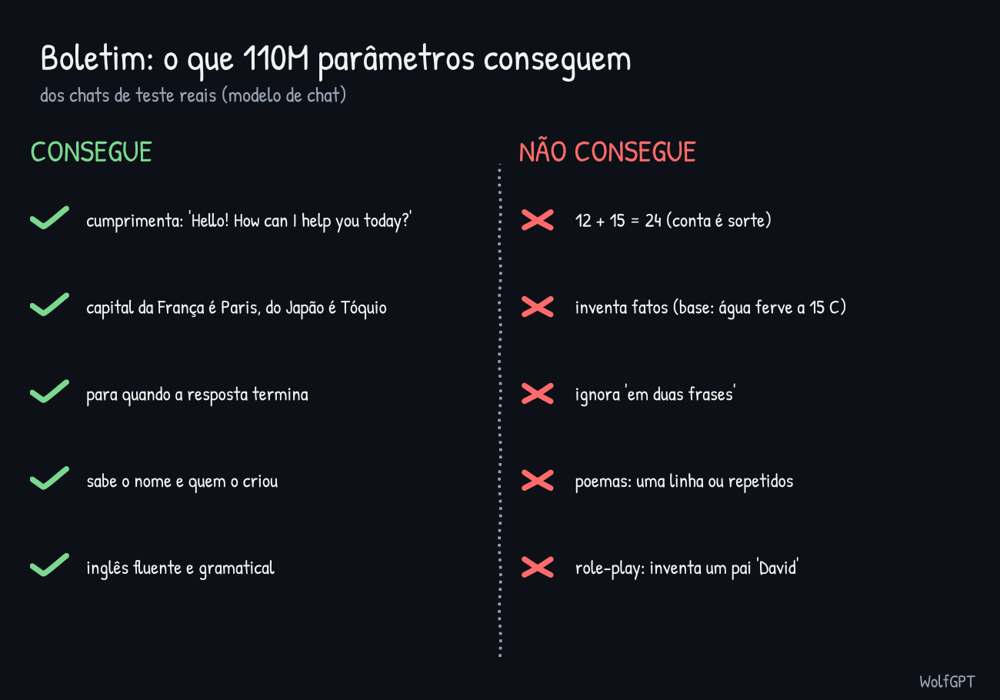


## O modelo

Transformer só de decodificador: 12 camadas, 12 cabeças, largura 768, contexto de 1.024 tokens, vocabulário de 32.768 (tokenizer BPE próprio), embeddings compartilhados, RoPE, RMSNorm, SwiGLU, sem dropout, 110.119.680 parâmetros. Pré-treinado com Muon (matrizes) + AdamW (embeddings, normalizações), bf16, `torch.compile`.

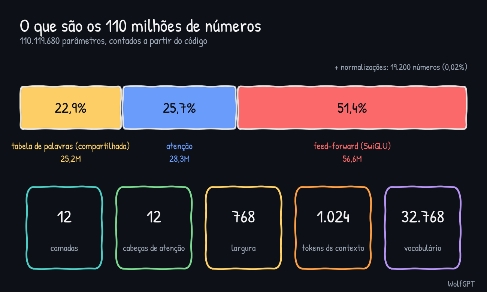


## A jornada, fase por fase

Todos os números abaixo foram medidos durante o projeto (logs de execução em `phase3/runs/`, `phase5/runs/`, `phase5/eval_results.json`, `benchmark_result.json`) ou contados a partir do código. As figuras são desenhadas por `make_figures.py` a partir desses arquivos.

### Fase 0: ambiente

WSL2 + Ubuntu no Windows 11, ambiente virtual Python no disco do Linux (não em `/mnt/c`, que é lento) e PyTorch 2.11 compilado para CUDA 12.8. A GPU é Blackwell (capacidade de computação 12.0, `sm_120`), então um PyTorch mais antigo não funcionaria. O driver NVIDIA do Windows (621.14) já era novo o bastante (é preciso 570 ou mais).

Velocidade medida de multiplicação de matrizes (mediana de 50 multiplicações, duas rodadas concordando em cerca de 2%): bf16 de 47,4 a 50,1 TFLOP/s, fp16 de 48,7 a 49,9 e tf32 de 24,2 a 25,1. O treino depois chegou a 33,0 TFLOP/s, cerca de dois terços do pico de bf16.

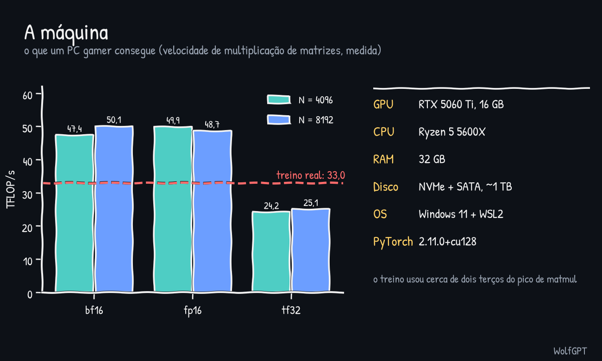

Dica que fez diferença: feche outros programas antes de treinos longos. Eles seguravam 3,4 GB de VRAM.

### Fase 1: um GPT minúsculo à mão

Dois GPTs de 10,75M de parâmetros que trabalham com caracteres (6 camadas, 6 cabeças, largura 384, contexto 256): um em Shakespeare em miniatura (inglês) e outro em Machado de Assis (português). Melhor loss de validação 1,462 (inglês) e 1,379 (português), alcançada após cerca de três minutos de treino. O inglês escreveu nomes de personagens e versos; o português escreveu um português do século XIX com gramática quebrada.

Sem parada antecipada, a loss de validação chegou ao mínimo de 1,469 e depois subiu para 1,679, enquanto a de treino continuou caindo até 0,625. Isso é overfitting, visto em minutos. O modelo em português também copiou nomes de personagens do seu texto de cerca de 1 MB (memorização).

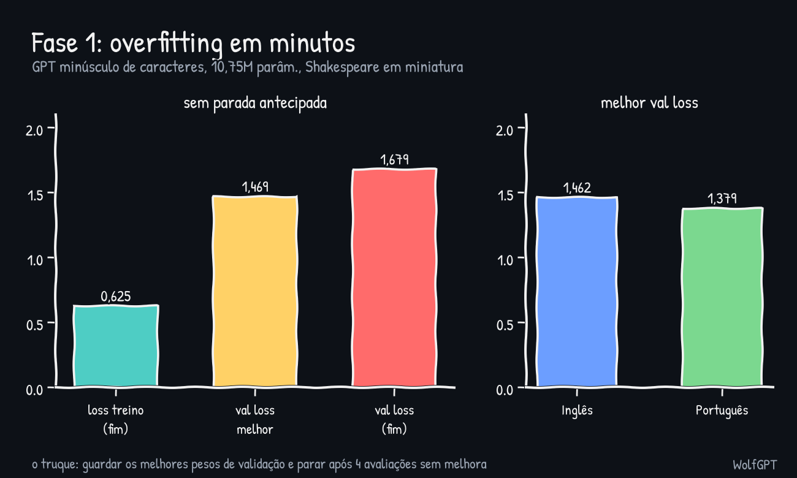

### Fase 2: dados e tokenizer

Só inglês no modelo principal (os textos em português de domínio público usam a ortografia anterior à reforma, então um modelo em português precisa antes de texto moderno). Dados: FineWeb-Edu `sample-10BT`, lido em streaming e dividido pela ordem dos documentos: 100 mil para o tokenizer, 10 mil para validação e o resto para treino.

O tokenizer é um BPE de bytes com 32.768 tokens, treinado em 57 segundos. Ele faz em média 4,61 caracteres por token em texto inédito (o modelo de caracteres da Fase 1 faz 1,00). A tokenização gerou 3.002.016.685 tokens de treino e 10.032.689 de validação, em cerca de 45 minutos a aproximadamente 1,1M tokens/s.

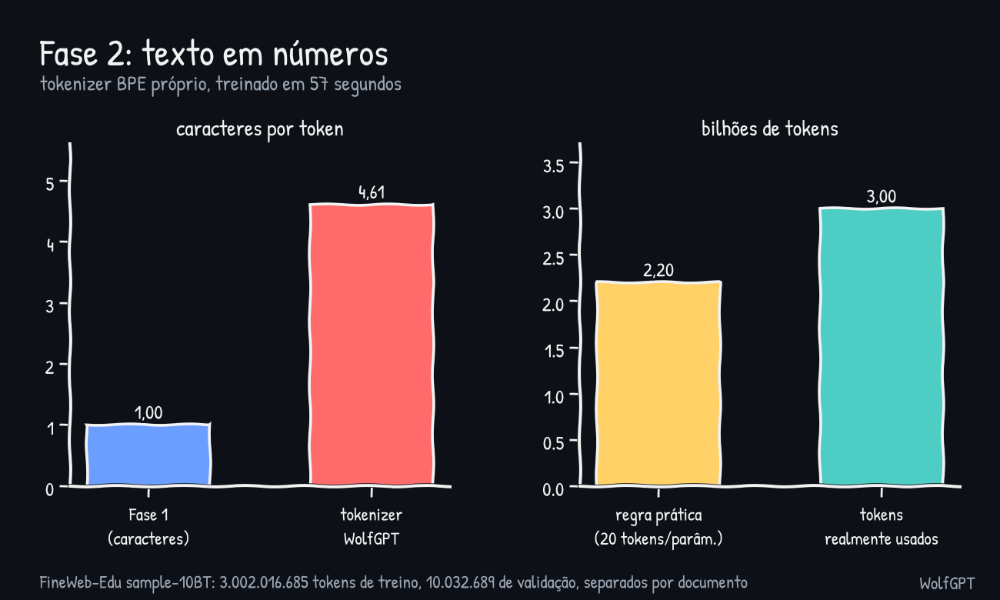

### Fase 3: o piloto, Muon vs AdamW

Um modelo de 47,9M de parâmetros (10 camadas, 8 cabeças, largura 512), 400 passos de 131.072 tokens (52M tokens), mesma ordem de dados e mesmo conjunto fixo de validação em todas as rodadas. Antes do piloto, uma revisão de código independente achou e corrigiu vários erros (veja [PHASE3_FIXES.md](phase3/PHASE3_FIXES.md)), então o piloto rodou no código corrigido.

Muon com lr 0,02 chegou a 4,418, Muon com lr 0,05 a 4,537, AdamW com lr 6e-4 a 5,280 e AdamW com lr 2e-3 a 5,352. O Muon ficou 0,86 abaixo (perplexidade cerca de 2,4 vezes menor) com cerca de 4% menos velocidade. Ressalvas: só 52M tokens (a diferença encolhe em treinos longos) e a grade do AdamW teve só dois pontos, com o melhor no extremo mais baixo.

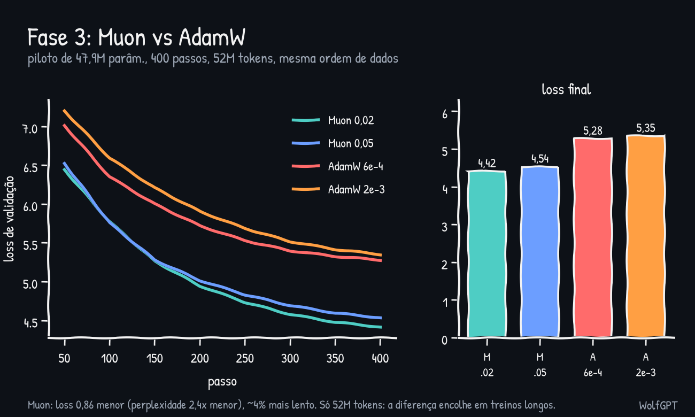

### Fase 4: o treino principal

O modelo: 110.119.680 parâmetros (12 camadas, 12 cabeças, largura 768, contexto 1.024, vocabulário 32.768), com embeddings de entrada e saída compartilhados, RoPE, RMSNorm e feed-forward SwiGLU. Metade dos números está nas camadas feed-forward.


Treino: Muon (lr 0,02) nas matrizes internas mais AdamW (lr 2e-3) nos embeddings e normalizações, 22.888 passos de 131.072 tokens (3,0 bi de tokens, uma única passada embaralhada), bf16, `torch.compile`. Rodou a 46,0 mil tokens/s e 33,0 TFLOP/s, pico de memória 6,5 GB, 18,1 horas. O treino foi parado e retomado pelo menos uma vez, e o código de retomada funcionou.

Loss de validação: 10,57 no passo 0, 4,22 no 500, 3,60 no 2.500, 3,28 no 10.000 e 3,129 no fim (perplexidade cerca de 22,8). A maior norma de gradiente em qualquer avaliação foi 2,28, sem picos. A loss de validação caiu até o último momento, então não houve overfitting.


O modelo base é fluente, mas pouco confiável: inventa fatos ("a água ferve a 15 graus"), entra em loop com temperatura baixa e trata "hello" como o começo de um artigo. Isso é esperado com 110M de parâmetros e 3 bi de tokens.

### Fase 5: chat (SFT) e identidade

Dados: smol-smoltalk (cerca de 460 mil chats sintéticos), everyday-conversations (saudações, repetidas 3 vezes só no treino) e Dolly 15k (escrito por humanos), 477.612 conversas no total. Depois de tirar primeiros pedidos repetidos e conversas cuja primeira troca passa de 1.024 tokens, sobraram 446.353 conversas de treino (267,5M tokens, 77% deles de resposta) e 1.000 de validação. A loss é calculada só nos tokens da resposta.

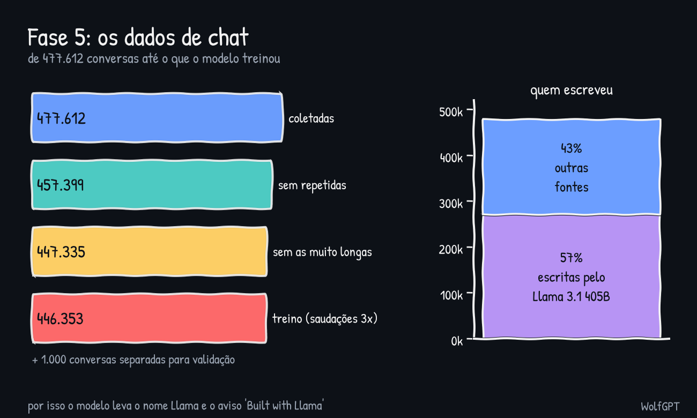

Teste de learning rate (1 época em 150 mil conversas, cerca de 48 minutos cada): 5e-5 deu 1,761, 1e-4 deu 1,706 e 3e-4 deu 1,630 (o modelo base estava em 2,395). A vencedora é o maior valor testado, então uma taxa maior talvez fosse melhor; isso não foi testado.

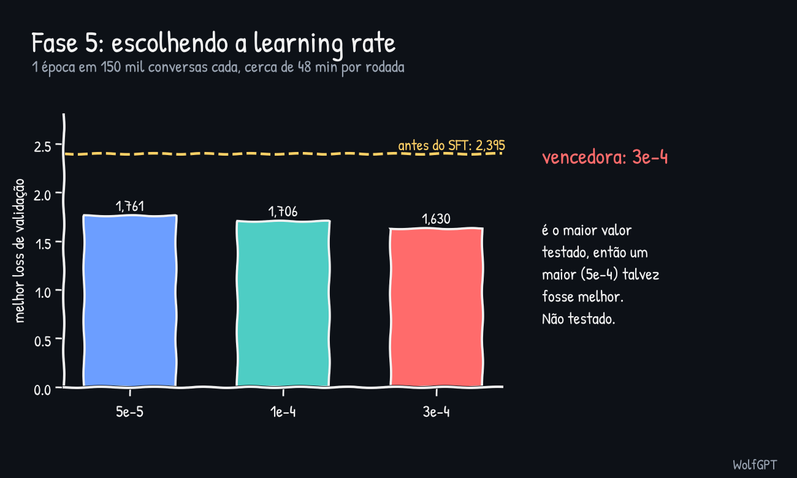

Rodada final: lr 3e-4, 2 épocas, 27.896 passos, 4,6 horas a 33,3 mil tokens/s. Loss de validação de 2,395 para 1,484. A época 1 terminou em 1,541 e a época 2 acrescentou só 0,057. O texto humano do Dolly tem a maior loss entre as fontes e o código a menor.

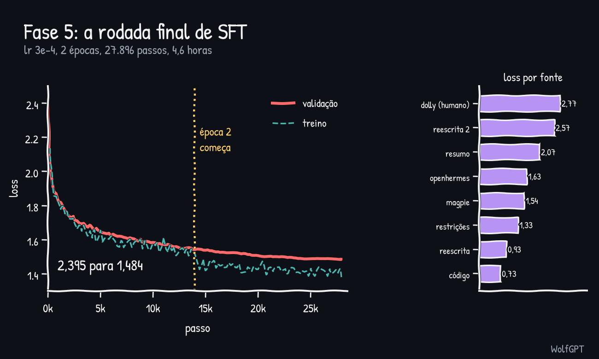

**Identidade.** O modelo não sabia quem era e inventou um pai chamado David. Um agente Haiku escreveu 300 conversas curtas, que foram revisadas (nome WolfGPT, um modelo de linguagem pequeno de cerca de 110M de parâmetros, criado por "Explorer"). A rodada 1 (lr 3e-5, cópias da identidade x3) foi suave demais: loss de identidade de 3,615 para 2,294, nome ainda truncado. A rodada 2 (lr 1e-4, cópias x8) aprendeu o nome mas decorou os chats repetidos: a loss de treino caiu a cerca de 1,0 enquanto a validação de chats comuns subiu de 1,488 para 1,516. O checkpoint de melhor validação (passo 200) era de antes de o nome ser aprendido, então o checkpoint do fim do treino, `wolf2_last.pt`, é o modelo de demonstração.

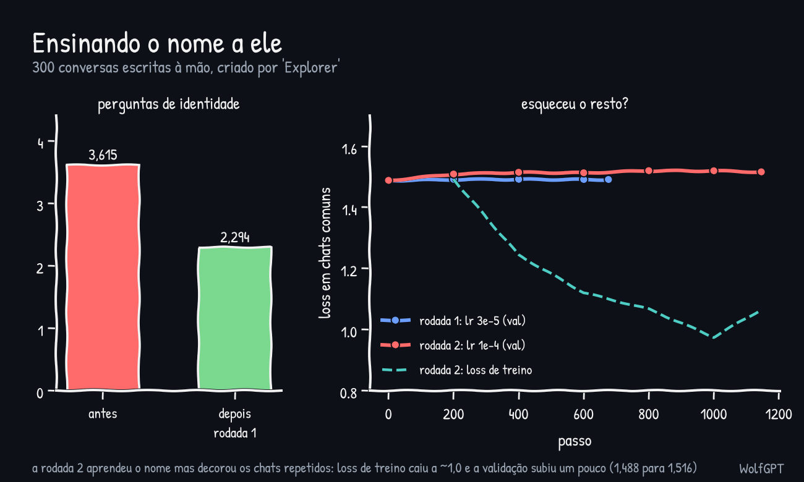

**Correções de repetição na hora do chat** (sem retreinar). Com a fase de identidade, mensagens curtas ("OK") faziam o modelo responder "I understand. I'm WolfGPT..." sem parar. O código do chat agora pontua cada resposta pelas frases repetidas de 4 tokens, rejeita as acima de 0,3 e gera de novo (mais quente, depois com menos memória). Proibir 4-gramas repetidos, em teste offline, levou 112 frases repetidas a 0. Um teste manual com 3 tentativas deu "muito melhor, perfeito" em conversa casual; o que sobra é fraqueza de conteúdo, não loops.

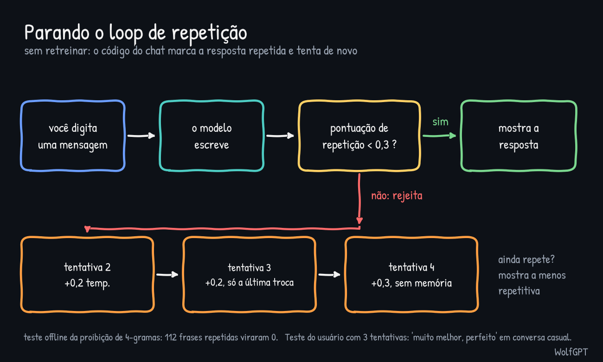

### Fase 6: benchmarks e publicação

Zero-shot, conjuntos de teste completos, pontuando cada resposta pela log-verossimilhança (acurácia normalizada pelo tamanho, exceto no Winogrande). O script foi conferido contra uma referência um-a-um (diferença de 1e-5). O erro padrão vai de cerca de 0,5 (HellaSwag) a 1,4 (Winogrande) pontos.


O modelo base fica acima do acaso em HellaSwag, ARC-Easy e PIQA e no acaso em ARC-Challenge e Winogrande. O SFT custa cerca de 8 pontos no ARC-Easy e 3 no PIQA, em parte porque os testes usam texto puro e não o formato de chat. Uma rodada inicial de 100 perguntas mostrou HellaSwag em 44%; era ruído de amostra pequena (o conjunto completo dá 32,3%).

Para onde foi o tempo de GPU, cerca de 26 horas no total:

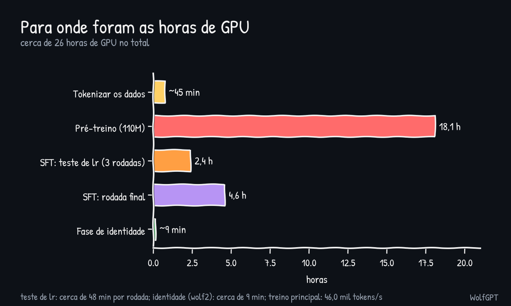

Publicação: o modelo é empacotado como `Llama-WolfGPT-110M` (safetensors, `model.py` e `chat.py` independentes, a licença Llama 3.1, um arquivo NOTICE e um model card com o aviso "Built with Llama"). Cerca de 57% dos dados de chat (270.838 de 477.612 conversas) foram escritos pelo Llama 3.1 405B, então a licença exige o nome Llama e o aviso. Nenhum peso ou código do Llama foi usado. Isto não é aconselhamento jurídico; leia a licença.


## O que eu aprendi

Cada lição diz de onde veio. "Medido" quer dizer um número das nossas próprias rodadas; "conselho" quer dizer algo que lemos ou nos disseram e não testamos.

### Sobre o treino

1. **Julgue pela loss de validação, nunca pela de treino.** Medido na Fase 1: a validação chegou ao mínimo de 1,469 e subiu para 1,679 enquanto o treino caía a 0,625. Guarde o checkpoint de melhor validação e pare depois de algumas avaliações sem melhora.
2. **Losses só se comparam com os mesmos dados e o mesmo tokenizer.** Os números do modelo de caracteres (1,4) e os do BPE (3,1) não são comparáveis.
3. **O otimizador pesou muito em escala pequena.** Medido: o Muon venceu o AdamW por 0,86 de loss no piloto de 52M tokens, com cerca de 4% menos velocidade. Ressalva: pilotos curtos exageram diferenças, e o AdamW só foi testado com duas learning rates.
4. **Conserte o código antes do treino longo.** A revisão independente achou problemas reais (dados vistos com repetição, uma atualização do Muon que favorecia um bloco, um conjunto de validação que dependia do tamanho do lote, falta de retomada). A retomada foi testada e dá pesos idênticos bit a bit, e o treino principal foi parado e retomado uma ou mais vezes sem problemas.
5. **Tokens por parâmetro.** 3,0 bi de tokens para 110M de parâmetros dão cerca de 27 tokens por parâmetro, acima da regra prática de 20, com uma passada pelos dados: a validação caiu até o fim (sem overfitting).
6. **Velocidade é, em grande parte, não desperdiçar a GPU.** O torch.compile deu +38% de velocidade e -38% de memória no piloto. A loss é somada na GPU com uma sincronização por passo. O treino chegou a 33,0 TFLOP/s, cerca de dois terços do pico de matmul.
7. **Contagem honesta de FLOPs.** A atenção causal faz metade do trabalho; contá-la inteira exagerava a velocidade em 8 a 10%.

### Sobre o ajuste fino (SFT)

8. **O SFT ensina formato, não conhecimento.** Depois do SFT o modelo cumprimenta, responde e para, mas os fatos continuam pouco confiáveis.
9. **Mascare o pedido, mantenha o token de fim.** Loss só nos tokens da resposta, e o token de fim de texto faz parte da resposta para o modelo aprender a parar.
10. **Remova duplicatas antes de dividir** para que cópias da validação não estejam no treino. Foram removidos 20.213 primeiros pedidos repetidos.
11. **Descarte, não corte, exemplos longos demais.** Cortar apagaria o token de fim e ensinaria que as respostas terminam em pontos aleatórios.
12. **Mais exemplos diferentes valem mais que mais passadas pelos mesmos.** O overfitting vem da repetição. A rodada final viu 446 mil chats distintos duas vezes; a segunda época acrescentou só 0,057.
13. **Teste a learning rate numa rodada mais curta.** 3e-4 ganhou com 1,630 contra 1,706 e 1,761, mas era a maior testada, então o ótimo pode ser mais alto.
14. **A loss de validação não mostra deriva.** Leia amostras. Modelos antigos do teste entravam em loop ("Read the text" x15); o final não.
15. **Etapas pequenas e específicas precisam de métrica específica.** O script guardava o checkpoint de melhor validação geral, que é 98% chats comuns, então escolheu o passo 200, antes de o nome ser aprendido. Para uma etapa pequena, use o último checkpoint ou meça o alvo.
16. **Repetir um conjunto minúsculo muitas vezes tem preço.** Chats de identidade x8 ensinaram o nome, mas também foram decorados (loss de treino ~1,0, validação subindo de 1,488 para 1,516) e fizeram o modelo recitar a identidade em mensagens curtas sem relação. A correção de fundo, não feita, é ter dados de conversa casual mais variados e menos cópias da identidade.
17. **O modelo copia a si mesmo.** O histórico do chat está no prompt, então um modelo pequeno repete as próprias respostas anteriores; temperatura baixa deixa os loops grudentos.

### Sobre a geração de texto

18. **Temperatura baixa gera loops.** Medido no modelo base: de 0,3 a 0,5 ele repetia as mesmas frases e sustentava fatos errados com confiança (a água ferve a 15 C). A faixa útil foi de cerca de 0,7 a 0,9 com top-k de 40 a 50 no modelo base.
19. **Resolva a repetição na hora do chat antes de retreinar.** Pontue as respostas pelas frases repetidas de 4 tokens, rejeite e tente de novo mais quente, corte no primeiro "###". Offline: 112 frases repetidas para 0. Só a proibição de n-gramas repetidos pode deixar as palavras estranhas quando o modelo não tem mais o que dizer, então ela é opcional.
20. **Digitar no prompt errado.** Um comando de terminal colado no chat é só texto para o modelo; ele o continua. Nada é executado.

### Sobre medir

21. **Amostras pequenas mentem.** 100 perguntas do HellaSwag deram 44%; as 10.042 completas deram 32,3%. Informe o tamanho da amostra e o erro padrão.
22. **Teste o código de avaliação** contra uma referência lenta um-a-um (diferença de 1e-5).
23. **O resultado honesto é misto.** O modelo base fica acima do acaso em HellaSwag, ARC-Easy e PIQA e no acaso em ARC-Challenge e Winogrande. O SFT baixa as notas em texto puro em alguns pontos. O modelo base fica quase igual ao GPT-2 124M no HellaSwag (31,1 informado para o GPT-2, outro código de avaliação, só aproximadamente comparável).

### Sobre dados e licenças

24. **Dados sintéticos herdam os termos de quem os gerou.** 57% das conversas de chat vieram do Llama 3.1 405B, então o modelo leva o nome Llama, o aviso "Built with Llama", a licença e um arquivo NOTICE. O Dolly é CC BY-SA 3.0 e o FineWeb-Edu é ODC-By: a atribuição é obrigatória. Não é aconselhamento jurídico.
25. **Não republique texto da web.** Aponte para a página do conjunto de dados.
26. **Dados sintéticos de personagem fazem modelos pequenos inventarem histórias.** Brincar de teatro com o modelo ("sou seu pai") o fez inventar um pai chamado David.

### Sobre o jeito de trabalhar

27. **Segredos.** Um token do Hugging Face foi colado num log do terminal; foi revogado na hora. Use variáveis de ambiente, mantenha o `.env` fora do git e nunca cole tokens em chats ou logs.
28. **Confira o que você entregou.** Arquivos enviados ao PC às vezes chegavam na versão anterior. A solução: esperar e comparar byte a byte.
29. **Rode um comando por vez.** Colar um comando com um chat ainda aberto o envia ao modelo como mensagem.
30. **Documentar no caminho é barato, reconstruir depois não é.** Cada fase tem um log datado; este repositório foi montado a partir deles.

### Ideias, não testadas

Só conselhos ou planos; nada foi construído nem medido.

- Treinar junto com outros PCs: o treino comum com paralelismo de dados exige conexões rápidas entre as máquinas, e a internet é lenta demais. Existem métodos de pouca comunicação (DiLoCo, OpenDiLoCo, INTELLECT-1) para isso; um teste com duas máquinas é uma ideia.
- Uma rodada de polimento (cerca de 150 chats casuais variados, menos cópias da identidade, escolher o checkpoint por uma métrica de identidade mais conversa casual).
- Learning rate 5e-4 no SFT; aritmética com rascunho usando dados gerados por programa; uma demo de recuperação de documentos (RAG) sobre as notas do projeto; mais tokens de pré-treino (a amostra de 10B) ou um modelo maior (cerca de 325M com contexto 2.048).
- Um modelo que "pensa" foi perguntado, mas não tentado.


## Decisões finais

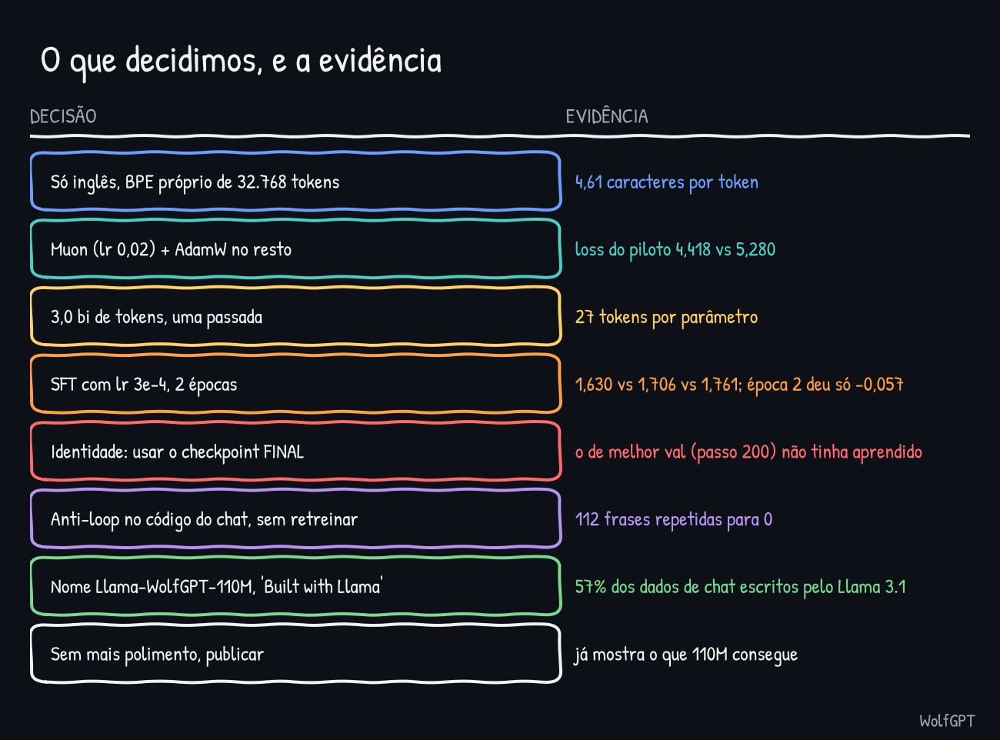

| # | Decisão | Por quê (evidência) | Não testado |
|---|---|---|---|
| 1 | Modelo só em inglês, tokenizer BPE de bytes próprio com 32.768 tokens | 4,61 caracteres por token; texto em português de domínio público usa a ortografia anterior à reforma | Um modelo em português ou bilíngue com texto moderno |
| 2 | FineWeb-Edu `sample-10BT`, 3,0 bi de tokens, uma passada | cerca de 27 tokens por parâmetro (regra prática 20); a validação caiu até o fim | A amostra completa de 10B |
| 3 | GPT só decodificador: 12 camadas, 12 cabeças, largura 768, contexto 1.024, embeddings compartilhados, RoPE, RMSNorm, SwiGLU, sem dropout. 110.119.680 parâmetros | cabe numa placa de 16 GB com folga (6,5 GB com micro-lote 8); classe de cerca de 125M | Cerca de 325M com contexto 2.048 (no limite dos 16 GB); 1B não cabe |
| 4 | Muon (lr 0,02, weight decay 0) nas matrizes internas, AdamW (lr 2e-3) em embeddings e normalizações | loss do piloto 4,418 contra 5,280 do AdamW | Weight decay no Muon; mais learning rates no AdamW |
| 5 | Decaimento cosseno até 10% do pico, aquecimento de 1% | funcionou: sem picos (maior norma de gradiente 2,28) | Decair até quase zero |
| 6 | Formato de chat `### User:` / `### Assistant:` mais o token de fim, loss só nas respostas | o modelo cumprimenta, responde e para | Outro formato |
| 7 | Mistura de SFT: smol-smoltalk + everyday-conversations (x3) + Dolly, sem duplicatas, exemplos longos descartados | 446.353 conversas de treino; validação de 2,395 para 1,484 | Só dados escritos por humanos |
| 8 | Learning rate de SFT 3e-4, 2 épocas | 1,630 contra 1,706 e 1,761; a época 2 acrescentou só 0,057 | 5e-4; 3 épocas |
| 9 | Ensinar o nome com 300 chats escritos à mão (identidade x8, lr 1e-4, 3 épocas) e usar o **último** checkpoint | o de melhor validação (passo 200) não tinha aprendido o nome | Uma receita mais suave com conversa casual |
| 10 | Resolver a repetição no código do chat: rejeitar e tentar de novo (limite 0,3, 3 tentativas), cortar em "###", proibição de n-gramas opcional | offline 112 frases repetidas para 0; teste do usuário "muito melhor, perfeito" | Retreinar com dados de conversa casual |
| 11 | Avaliar zero-shot em cinco benchmarks públicos, conjuntos completos, e publicar também os números fracos | modelo base acima do acaso em três de cinco | Few-shot, avaliação no formato de chat |
| 12 | Parar de melhorar e publicar: o projeto provou o que 110M de parâmetros conseguem | decidido pelo autor depois dos benchmarks | A rodada de polimento |
| 13 | Nome `Llama-WolfGPT-110M`, "Built with Llama", licença + NOTICE | 57% dos dados de chat foram escritos pelo Llama 3.1 405B | Retreinar sem esses dados |
| 14 | Pesos e model card no Hugging Face (privado primeiro), código e docs aqui no GitHub (privado primeiro), licença MIT para o código | os pesos seguem a Llama 3.1 Community License, que não cobre o código | |

### Como ler isto

As decisões foram tomadas com a evidência disponível na hora. Várias vencedoras estão no limite do que foi testado (a learning rate do SFT, a do Muon contra o AdamW), então são boas escolhas, não ótimos provados. A última coluna lista o que não tentamos.


## Glossário

Definições em linguagem simples dos termos usados enquanto construí o WolfGPT, escritas do jeito que fui aprendendo.

### Hardware e software

**GPU** - A placa de vídeo. Faz um monte de cálculos simples ao mesmo tempo, que é exatamente o que redes neurais precisam. A nossa: NVIDIA RTX 5060 Ti.

**VRAM** - A memória da própria GPU (16 GB aqui). Os pesos do modelo, os dados que estão sendo processados e o estado do treino precisam caber nela. É por isso que um modelo de 1B de parâmetros não cabe nesta placa.

**Tensor cores** - Circuitos especiais da GPU que multiplicam pequenos blocos de números de uma só vez. As altas velocidades em 16 bits vêm deles.

**CUDA** - A camada de software da NVIDIA que deixa os programas rodarem na GPU.

**Compute capability / sm_120** - A versão da arquitetura da GPU. A nossa é 12.0 (Blackwell). O PyTorch precisa trazer código compilado para ela, por isso este projeto exige uma versão com CUDA 12.8 ou mais nova.

**WSL2** - Windows Subsystem for Linux 2: um Linux de verdade rodando dentro do Windows. As ferramentas de IA rodam no Linux, usando o driver de GPU do Windows.

**venv (ambiente virtual)** - Uma pasta isolada de pacotes Python para um projeto, para que as instalações não afetem mais nada. Precisa ser ativada em cada terminal novo (`source ~/wolfgpt-env/bin/activate`); o prompt passa a começar com (wolfgpt-env).

**PyTorch** - A biblioteca Python usada para construir e treinar redes neurais na GPU.

**torch.compile** - O compilador do PyTorch para o modelo. No piloto deu +38% de velocidade e -38% de memória.

### Matemática e velocidade

**Matriz / matmul (multiplicação de matrizes)** - Uma matriz é uma grade de números. Multiplicar duas grades quer dizer: para cada célula do resultado, multiplicar uma linha de uma por uma coluna da outra e somar. Um GPT é quase só matmul repetida bilhões de vezes, por isso a medimos.

**FLOP** - Uma operação aritmética (uma multiplicação ou uma soma). Multiplicar duas matrizes N x N custa cerca de 2 x N^3 FLOPs.

**TFLOP/s** - Trilhões de FLOPs por segundo. A nossa velocidade medida em bf16 é de cerca de 50 TFLOP/s.

**Formatos de número**
- **fp32** - 32 bits por número. Preciso, mas lento.
- **fp16** - 16 bits. Mais rápido e metade da memória, mas com um alcance estreito de tamanhos, então pode estourar.
- **bf16** - 16 bits com o mesmo alcance do fp32 mas menos detalhe. Quase nunca estoura, por isso é o nosso formato de treino.
- **TF32** - entradas fp32 arredondadas durante a multiplicação. Cerca de metade da velocidade do bf16 aqui.

**MFU (aproveitamento de FLOPs do modelo)** - A fração do pico medido que o treino real usa. O treino também move dados e faz outras contas, então 30-50% é comum. O treino principal do WolfGPT usou cerca de dois terços (33,0 de cerca de 50 TFLOP/s).

### O modelo

**Parâmetros (os "110M")** - Os números aprendidos dentro do modelo. 110M quer dizer 110 milhões deles (110.119.680 exatamente). Mais dados nunca acrescentam parâmetros; só um formato diferente de modelo acrescenta.

**Pesos** - Outra palavra para os parâmetros. O treino os ajusta.

**Token** - Um pedaço de texto, mais ou menos três quartos de uma palavra. "Tokens por segundo" é a velocidade com que o treino lê texto.

**Tokenizer / BPE** - O programa que corta o texto em tokens. O BPE de bytes (byte-pair encoding) monta o vocabulário (32.768 tokens aqui) juntando repetidamente os pares de bytes mais frequentes.

**Janela de contexto (tamanho do contexto)** - Quantos tokens o modelo consegue olhar de uma vez. WolfGPT: 1.024. Qualquer coisa maior não cabe, e o modelo só foi treinado em posições até 1.024.

**GPT** - Generative Pre-trained Transformer: um modelo treinado para prever o próximo token.

**Atenção, RoPE, RMSNorm, SwiGLU, embeddings compartilhados** - A atenção deixa cada token olhar para os anteriores. O RoPE diz à atenção onde cada token está. O RMSNorm mantém os números numa faixa estável entre as camadas. O SwiGLU é uma camada feed-forward com portão (metade dos parâmetros do WolfGPT está nela). Embeddings compartilhados quer dizer que a tabela de palavras da entrada e a da saída são os mesmos números.

**Perplexidade** - e elevado à loss: mais ou menos, entre quantas palavras o modelo está dividido a cada passo. Modelo base do WolfGPT: cerca de 22,8.

**Treino** - Mostrar texto ao modelo repetidamente, medir o quanto os palpites do próximo token estão errados (a loss) e empurrar os pesos para errarem menos.

### Como o treino é organizado

**Época** - Uma passada completa por todo o conjunto de treino. O pré-treino teve menos de uma época (cada um dos 3 bi de tokens visto cerca de uma vez). O SFT usa 2 épocas. Mais passadas ajudam o aprendizado no começo, mas passadas demais fazem o modelo decorar os exemplos (overfitting). Muitos exemplos diferentes vistos uma ou duas vezes são mais seguros que poucos exemplos vistos muitas vezes.

**Passo, lote, micro-lote** - Um passo é uma atualização dos pesos. Um lote é o grupo de exemplos usado nessa atualização (32 conversas no SFT). Um micro-lote é a fatia que cabe na GPU de uma vez; os resultados de várias fatias são somados antes da atualização (acúmulo de gradiente). No SFT as fatias são dimensionadas por tokens (4.096), não por número de conversas.

**Padding** - Tokens de enchimento acrescentados aos exemplos curtos para que todos os exemplos de um lote tenham o mesmo tamanho. Eles são ignorados na loss.

**Otimizador (AdamW, Muon)** - A regra de como atualizar os pesos a partir do gradiente. O AdamW é a escolha comum. O Muon é mais novo e é usado nas matrizes internas; no piloto chegou a uma loss de 4,418 contra 5,280 do AdamW.

**Learning rate (taxa de aprendizado)** - O tamanho de cada atualização dos pesos. Alta demais: treino instável ou esquecer o que o modelo sabia. Baixa demais: lento. **Aquecimento (warm-up)**: começar pequena e subir nos primeiros passos. **Decaimento cosseno**: baixar suavemente, aqui até 10% do pico no fim. Um **teste de learning rate (sweep)** experimenta vários valores numa rodada mais curta e fica com o melhor.

**Gradient clipping / norma do gradiente** - Limitar o tamanho de uma única atualização. Um pico na norma do gradiente avisa que o treino está ficando instável (a maior vista no treino principal foi 2,28: sem picos).

**Loss de treino vs loss de validação** - A loss de treino é medida nos dados com que o modelo aprende; a de validação em dados reservados com que ele nunca treina. A validação é o número honesto.

**Overfitting** - A loss de treino continua caindo enquanto a de validação para de melhorar ou sobe: o modelo está decorando em vez de aprender (visto na Fase 1, em minutos). Guardar o checkpoint de melhor validação protege contra isso.

**Checkpoint** - Uma cópia salva do modelo (e, se quiser, do otimizador e da posição nos dados) para o treino poder continuar depois de uma queda.

**Snapshot de retomada** - Um checkpoint que guarda também o estado do otimizador, o estado dos números aleatórios e a posição nos dados, para que uma rodada interrompida continue exatamente de onde parou e termine com os mesmos pesos. Rodar o run_overnight.sh de novo usa isso automaticamente.

**Smoke test** - Uma rodada minúscula (cerca de 20 passos) que confere se tudo funciona antes de começar a rodada longa.

### Dados

**Deduplicação** - Remover exemplos repetidos. Necessária para que uma cópia de um exemplo de validação não esteja também nos dados de treino.

**Vazamento de dados** - Quando exemplos de validação (ou cópias deles) são vistos durante o treino, então a loss de validação parece melhor do que o modelo realmente é.

**Conversas descartadas** - No preparo dos dados de SFT, conversas cuja primeira pergunta e resposta juntas passam de 1.024 tokens são removidas (cerca de 2%). Cortá-las apagaria o fim da resposta, incluindo o token de fim de texto, e ensinaria ao modelo que as respostas terminam em pontos aleatórios. Turnos posteriores de um chat com várias trocas que não cabem são cortados inteiros.

**Mensagem de sistema** - Uma instrução dada ao modelo antes da mensagem do usuário (por exemplo "resuma em uma frase"). Só a mantemos nos subconjuntos de reescrita e resumo, onde a tarefa está nela.

**Dados sintéticos** - Texto de treino escrito por outro modelo de IA em vez de por humanos. Barato e abundante, mas herda os erros e o estilo desse modelo, e seus termos de uso. O smol-smoltalk é sintético; o Dolly foi escrito por humanos.

**Magpie** - Um método para gerar dados sintéticos de instrução. Um modelo de chat recebe só o começo de um turno do usuário (o modelo de texto que normalmente vem antes de uma pergunta), então ele mesmo inventa a pergunta; depois um modelo a responde. Isso gera conjuntos enormes e variados de perguntas sem escrever prompts à mão. O magpie-ultra foi feito assim com o Llama 3.1 405B-Instruct; o **smol-magpie-ultra** é a versão de conversas mais curtas preparada para modelos abaixo de 1B de parâmetros, e é a maior parte do smol-smoltalk (57% da mistura). Como o texto vem do Llama, os termos da licença dele valem para o WolfGPT.

**Upsampling / repetição de uma fonte pequena** - Mostrar uma fonte pequena mas importante várias vezes (aqui as saudações do everyday-conversations, x3, só no treino) para ela não ser afogada por outros 450 mil chats. A validação nunca é repetida.

### Tornando o modelo útil

**Modelo base** - Um modelo que só continua texto (o que o WolfGPT é depois da Fase 4). Não responde perguntas nem conversa.

**Fine-tuning (ajuste fino)** - Continuar treinando um modelo já treinado num conjunto menor e específico, então os pesos dele mudam. Serve para mudar comportamento e formato, não para acrescentar muitos fatos confiáveis. Como ensinar uma habilidade a um aluno.

**SFT (ajuste fino supervisionado)** - Ajuste fino com conversas de exemplo (uma pergunta e a resposta que queremos). É a Fase 5: transforma o modelo base num modelo de chat.

**Mascaramento da loss** - No SFT, só os tokens da resposta contam para a loss; a pergunta do usuário é dada ao modelo mas não é pontuada, então ele aprende a responder em vez de imitar perguntas.

**Template de chat** - O formato fixo de texto de uma conversa ("### User: ... ### Assistant: ..."), mais um token de fim de texto que diz ao modelo quando a resposta terminou.

**Fase de identidade** - Um ajuste fino extra e curto em conversas escritas à mão que ensinam ao modelo o nome dele e quem o criou. Repetir um conjunto minúsculo muitas vezes ensinou o nome, mas também fez o modelo decorá-lo e recitá-lo em mensagens curtas sem relação.

**LoRA** - Um ajuste fino mais barato que treina só pequenas camadas extras em vez de todos os pesos. Economiza memória; não é necessário aqui porque o modelo inteiro de 110M cabe na GPU.

**RAG (geração com recuperação de documentos)** - Na hora da pergunta, buscar numa coleção de documentos, colar os melhores trechos no prompt e deixar o modelo responder a partir deles. O modelo não é retreinado, então os fatos mudam editando os documentos. Como uma prova com consulta. Limitado aqui pelo contexto de 1.024 tokens e pela leitura fraca do modelo pequeno. Uma ideia, não construída.

**Alucinação** - Texto fluente que afirma fatos inventados. O WolfGPT faz isso muito com 110M de parâmetros (as 3.800 células do coração, o ponto de ebulição de 15 graus).

### Amostragem (como o texto é gerado)

**Temperatura** - Controla a aleatoriedade ao escolher a próxima palavra. Baixa (0,3): sempre a palavra mais segura, o que causa loops. Alta (1,0+): mais variado, mas com mais besteira. De 0,7 a 0,9 funciona melhor no modelo base.

**Top-k** - Escolher só entre as k próximas palavras mais prováveis (usamos 40-50), o que corta as palavras muito improváveis.

**Penalidade de repetição** - Uma configuração de amostragem que baixa a nota das palavras já usadas na resposta, o que reduz os loops. A nossa é uma subtração fixa, desligada por padrão.

**Proibição de n-gramas repetidos** - Proibir gerar uma frase de N tokens que já apareceu. Eliminou todas as frases repetidas de 4 tokens num teste offline, mas pode gerar palavras estranhas quando o modelo não tem mais o que dizer.

**Rejeitar e tentar de novo** - Depois de cada resposta, medir o quanto ela repete respostas anteriores; se passar de um limite (0,3), jogar fora e gerar de novo, um pouco mais quente e com menos memória. Não precisa retreinar.

### Avaliação

**Zero-shot** - Testado sem nenhum exemplo no prompt. **Benchmark** - Um conjunto de teste público com respostas conhecidas.

**HellaSwag, ARC-Easy, ARC-Challenge, PIQA, Winogrande** - Testes de múltipla escolha de bom senso e ciências. O modelo pontua o texto de cada resposta pela log-verossimilhança e escolhe a melhor. O chute aleatório dá 25% nos três primeiros e 50% nos dois últimos.

**acc / acc_norm** - Acurácia, e acurácia com a nota de cada resposta dividida pelo tamanho dela (para respostas longas não serem punidas).

**Erro padrão** - O quanto uma nota oscilaria com outra amostra de perguntas. Cerca de 0,5 ponto no HellaSwag e 1,4 no Winogrande.

### Licenças

**Llama 3.1 Community License** - Se saídas do Llama são usadas para treinar um modelo distribuído, o nome do modelo deve começar com "Llama", mostrar "Built with Llama" e incluir a licença e um arquivo NOTICE. Não é aconselhamento jurídico.

**ODC-By, CC BY-SA** - Licenças que exigem atribuição (e, no CC BY-SA, compartilhar sob os mesmos termos). O FineWeb-Edu é ODC-By; o Dolly é CC BY-SA 3.0.

**safetensors** - Um formato de arquivo seguro para pesos de modelos (diferente dos arquivos pickle, não consegue executar código ao ser carregado).


## Mapa do repositório

| Pasta / arquivo | O que é |
|---|---|
| `01_install_ubuntu.ps1`, `02_setup_env.sh`, `03_run_ai.ps1`, `benchmark.py` | Fase 0: instalação do WSL2 + Ubuntu, ambiente Python, benchmark da GPU, script de execução |
| `phase1/` | Fase 1: um GPT minúsculo de caracteres escrito à mão |
| `phase2/` | Fase 2: treino do tokenizer e tokenização da amostra do FineWeb-Edu |
| `phase3/` | Fases 3-4: modelo, otimizador Muon, treino, piloto e treino principal, geração de texto, correções da revisão de código |
| `phase5/` | Fases 5-6: preparo dos dados de chat, SFT, chat, benchmarks, exportação da versão final, model card |
| `docs/` | O registro escrito: jornada, aprendizados, decisões, glossário, logs por fase, infográficos (`docs/img/`), versões em português (`docs/pt-BR/`) |
| `make_figures.py` | Desenha os infográficos a partir dos arquivos das rodadas (`python make_figures.py --data . --out docs/img`) |
| `LOG.md`, `GLOSSARY.md` | Log e glossário iniciais (as versões completas estão em `docs/`) |

Arquivos grandes (dados, checkpoints, pesos do modelo) **não** estão neste repositório: veja o `.gitignore`. Os pesos estão no Hugging Face.


## Reproduzindo (resumo)

Hardware usado: uma GPU NVIDIA de 16 GB (Blackwell, `sm_120` exige um PyTorch para CUDA 12.8 ou mais novo), Windows 11 + WSL2 Ubuntu. Pacotes Python: veja `requirements.txt`.

1. Ambiente e benchmark da GPU: scripts da Fase 0; detalhes em `docs/pt-BR/JORNADA.md`.
2. Dados e tokenizer (Fase 2), depois piloto e pré-treino principal (`phase3/run_pilot.sh`, `phase3/run_main.sh`).
3. Ajuste fino para chat, em `phase5/`:
   ```
   python prep_sft.py          # baixa e prepara ~457 mil conversas
   bash run_overnight.sh       # teste de learning rate, depois a rodada completa (retomável)
   python prep_identity.py --val_orig 980 --id_rep 8 --out ~/wolfgpt-data/sft_id2
   python sft.py --base ~/wolfgpt-data/ckpt/final_best.pt --data_dir ~/wolfgpt-data/sft_id2 --tag wolf2 --lr 1e-4 --epochs 3
   ```
4. Chat: `python chat.py --ckpt ~/wolfgpt-data/ckpt/wolf2_last.pt --temperature 0.4 --rep_penalty 0.3 --retries 3`
5. Benchmarks: `python eval_bench.py --ckpt <checkpoints>`; pasta da versão final: `python export_release.py`.

Caminhos como `~/wolfgpt-data/` são onde o autor guardou dados e checkpoints no lado Linux do WSL; troque como precisar.


## Licenças e dados

- **Código:** veja o `LICENSE` na raiz do repositório.
- **Modelo:** feito com Llama. Parte das conversas de ajuste fino (o subconjunto Smol-Magpie-Ultra do smol-smoltalk, cerca de 57% da mistura) foi gerada com o Llama-3.1-405B-Instruct, então o modelo é publicado sob a **Llama 3.1 Community License** e se chama "Llama-WolfGPT-110M". Nenhum peso ou código do Llama foi usado: o WolfGPT foi pré-treinado do zero. Veja `phase5/MODEL_CARD.md`.
- **Dados:** FineWeb-Edu (pré-treino), smol-smoltalk e everyday-conversations (HuggingFaceTB), Databricks Dolly 15k (CC BY-SA 3.0), mais 300 conversas de identidade escritas à mão. Cada conjunto mantém a própria licença; confira antes de reutilizar o modelo ou os dados comercialmente.
- Fonte dos infográficos: Patrick Hand (SIL Open Font License), não incluída no repositório.
- Este é um resumo de boa-fé, não aconselhamento jurídico.


## Agradecimentos

Otimizador Muon (Keller Jordan e colegas), o conjunto FineWeb-Edu e o trabalho SmolLM / smol-smoltalk do Hugging Face, o método de dados Magpie e o Llama 3.1 da Meta (cujas saídas estão nos dados de ajuste fino).


</details>

---

A small GPT (110 million parameters) built, trained and fine-tuned **from zero** on one consumer GPU (RTX 5060 Ti, 16 GB), with every step documented. The goal was to learn how language models really work by building one end to end: environment, a tiny GPT by hand, data and tokenizer, optimizer experiments, a 3-billion-token pretraining run, chat fine-tuning, benchmarks and release.

> The finished model is published as **Llama-WolfGPT-110M** (Hugging Face: [explorerkiil/Llama-WolfGPT-110M](https://huggingface.co/explorerkiil/Llama-WolfGPT-110M)). It is a learning project and a chatting demo, not a reliable assistant.

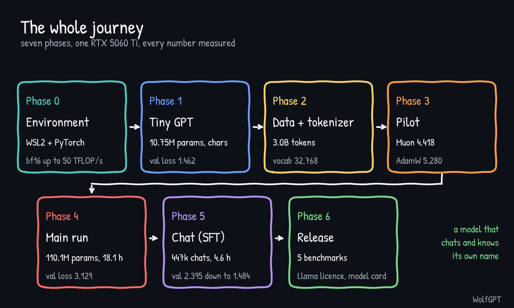

[What came out of it](#what-came-out-of-it) · [The model](#the-model) · [The journey, phase by phase](#the-journey-phase-by-phase) · [What I learned](#what-i-learned) · [Final decisions](#final-decisions) · [Glossary](#glossary) · [Repository map](#repository-map) · [Reproducing it (outline)](#reproducing-it-outline) · [Licences and data](#licences-and-data) · [Acknowledgements](#acknowledgements)

## What came out of it

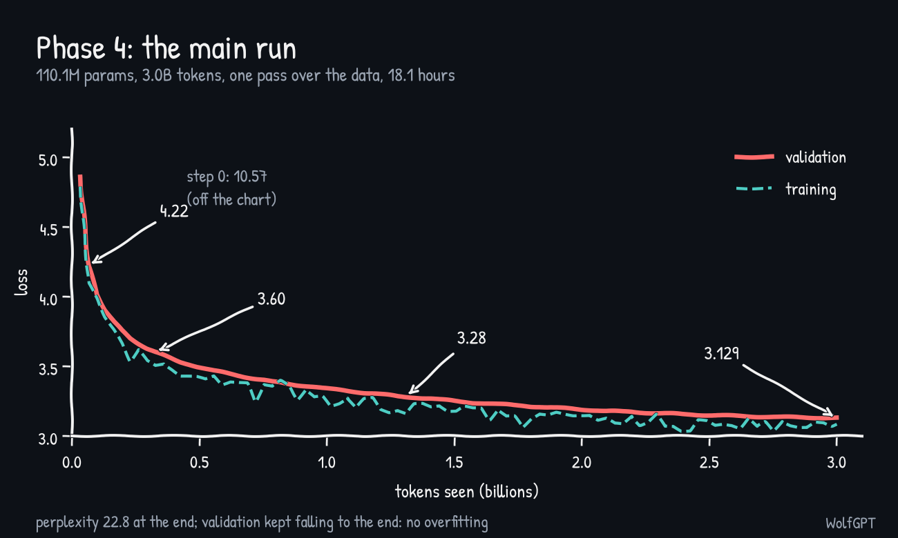

| Stage | Result |
|---|---|
| Pretraining (FineWeb-Edu sample, 3.0B tokens, 18.1 h) | validation loss 3.129 (perplexity about 22.8) |
| Chat fine-tuning (SFT, 446k conversations, 267M tokens, 4.6 h) | validation loss 2.395 to 1.484 |
| Identity stage (300 hand-written conversations) | answers "I'm WolfGPT... built by Explorer" |

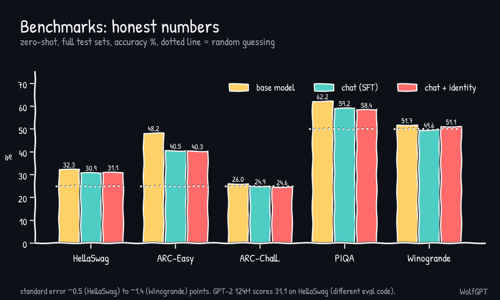

Above chance on HellaSwag, ARC-Easy and PIQA; at chance on the tests that need real reasoning. Facts are often wrong, arithmetic is unreliable and it invents stories when role-played at.

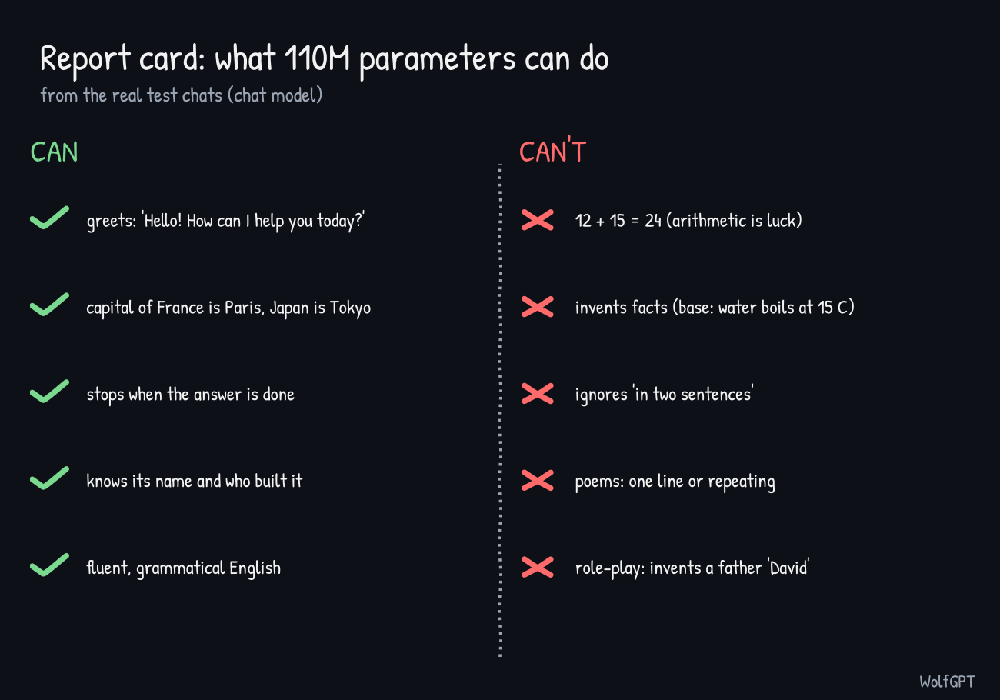


## The model

Decoder-only transformer: 12 layers, 12 heads, width 768, context 1,024 tokens, vocabulary 32,768 (own BPE tokenizer), tied embeddings, RoPE, RMSNorm, SwiGLU, no dropout, 110,119,680 parameters. Pretrained with Muon (matrices) + AdamW (embeddings, norms), bf16, `torch.compile`.

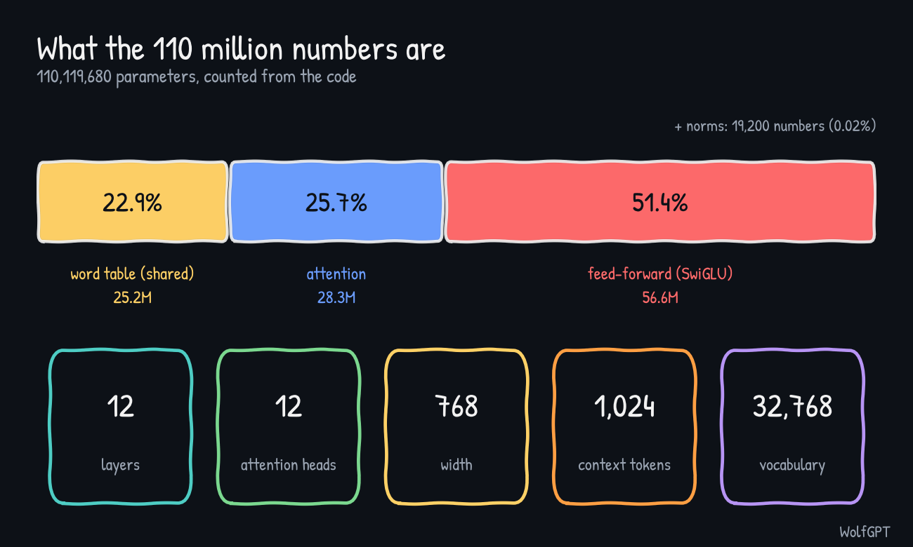


## The journey, phase by phase

Every number below was measured during the project (run logs in `phase3/runs/`, `phase5/runs/`, `phase5/eval_results.json`, `benchmark_result.json`) or counted from the code. Figures are drawn by `make_figures.py` from those files.

### Phase 0: environment

WSL2 + Ubuntu on Windows 11, Python virtual environment on the Linux disk (not `/mnt/c`, which is slow), PyTorch 2.11 built for CUDA 12.8. The GPU is Blackwell (compute capability 12.0, `sm_120`), so an older PyTorch build would not work. The NVIDIA Windows driver (621.14) was already new enough (570 or newer is required).

Measured matrix-multiply speed (median of 50 multiplications, two runs agreeing within about 2%): bf16 47.4 to 50.1 TFLOP/s, fp16 48.7 to 49.9, tf32 24.2 to 25.1. Training later reached 33.0 TFLOP/s, about two thirds of the bf16 peak.

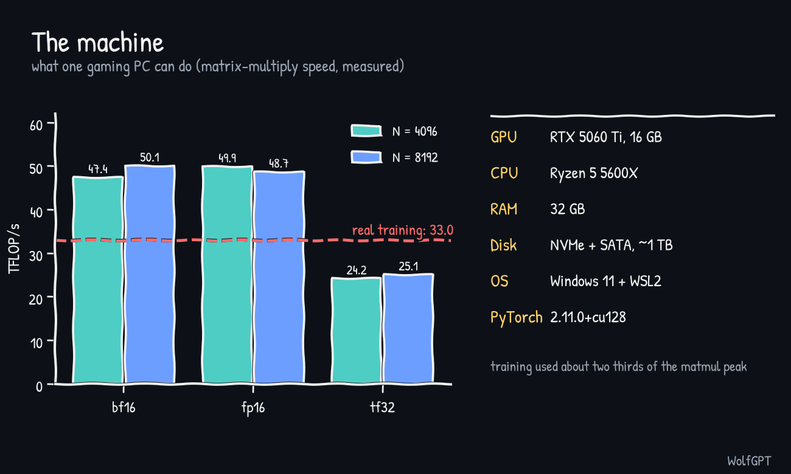

Tip that mattered: close other programs before long runs. They held 3.4 GB of VRAM.

### Phase 1: a tiny GPT by hand

Two 10.75M-parameter character-level GPTs (6 layers, 6 heads, width 384, context 256), one on tiny Shakespeare (English) and one on Machado de Assis (Portuguese). Best validation loss 1.462 (English) and 1.379 (Portuguese), reached after about three minutes of training. The English sample had speaker names and verse; the Portuguese one wrote 1800s-style Portuguese with broken grammar.

Without early stopping the validation loss bottomed at 1.469 and then rose to 1.679 while the training loss kept falling to 0.625. That is overfitting, seen within minutes. The Portuguese model also copied character names from its roughly 1 MB of text (memorisation).


### Phase 2: data and tokenizer

English only for the main model (Portuguese public-domain text is pre-reform spelling, so a Portuguese model needs modern text first). Data: FineWeb-Edu `sample-10BT`, streamed, split by document order: 100k documents for the tokenizer, 10k for validation, the rest for training.

The tokenizer is a byte-level BPE with 32,768 tokens, trained in 57 seconds. It averages 4.61 characters per token on unseen text (the Phase 1 character model has 1.00). Tokenizing gave 3,002,016,685 training tokens and 10,032,689 validation tokens, about 45 minutes at roughly 1.1M tokens/s.


### Phase 3: the pilot, Muon vs AdamW

A 47.9M-parameter model (10 layers, 8 heads, width 512), 400 steps of 131,072 tokens (52M tokens), same data order and the same fixed validation set in every run. Before the pilot, an independent code review found and fixed several bugs (see [PHASE3_FIXES.md](phase3/PHASE3_FIXES.md)), so the pilot was run on the corrected code.

Muon with lr 0.02 reached 4.418, Muon with lr 0.05 reached 4.537, AdamW with lr 6e-4 reached 5.280 and AdamW with lr 2e-3 reached 5.352. Muon was 0.86 lower (perplexity about 2.4 times lower) for about 4% less speed. Caveats: only 52M tokens (the gap shrinks in long runs), and the AdamW grid had only two points, with the better one at the lower end.

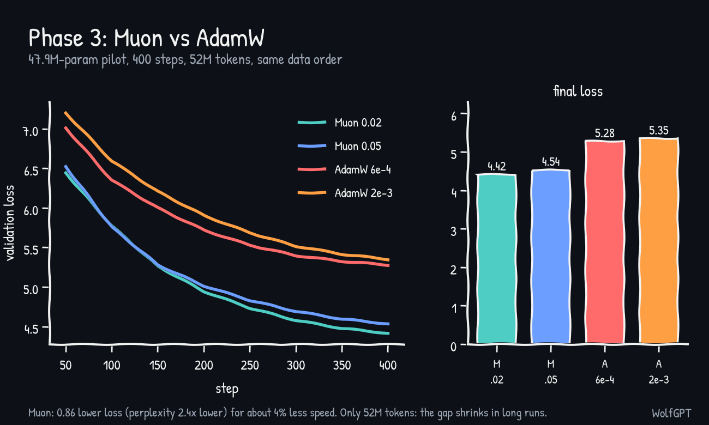

### Phase 4: the main run

The model: 110,119,680 parameters (12 layers, 12 heads, width 768, context 1,024, vocabulary 32,768), with tied input/output embeddings, RoPE, RMSNorm and a SwiGLU feed-forward. Half of the numbers live in the feed-forward layers.


Training: Muon (lr 0.02) on the hidden matrices plus AdamW (lr 2e-3) on embeddings and norms, 22,888 steps of 131,072 tokens (3.0B tokens, a single shuffled pass), bf16, `torch.compile`. It ran at 46.0k tokens/s and 33.0 TFLOP/s, peak memory 6.5 GB, 18.1 hours. The run was stopped and resumed at least once, and the resume code worked.

Validation loss: 10.57 at step 0, 4.22 at step 500, 3.60 at step 2,500, 3.28 at step 10,000 and 3.129 at the end (perplexity about 22.8). The largest gradient norm seen at any evaluation was 2.28, so there were no spikes. Validation loss kept falling to the very end, so there was no overfitting.


The base model is fluent but unreliable: it invents facts ("water boils at 15 degrees"), loops at low temperature and treats "hello" as the start of an article. That is expected for 110M parameters and 3B tokens.

### Phase 5: chat (SFT) and identity

Data: smol-smoltalk (about 460k synthetic chats), everyday-conversations (greetings, repeated 3 times in training only) and Dolly 15k (human-written), 477,612 conversations in total. After removing repeated first prompts and conversations whose first exchange exceeds 1,024 tokens, 446,353 training conversations (267.5M tokens, 77% of them answer tokens) and 1,000 validation conversations remained. Loss is computed on answer tokens only.


Learning-rate sweep (1 epoch on a 150k subset, about 48 minutes each): 5e-5 gave 1.761, 1e-4 gave 1.706 and 3e-4 gave 1.630 (the base model was 2.395). The winner is the highest value tried, so a higher rate might do better; that was not tested.

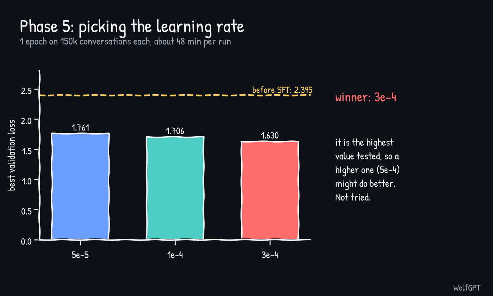

Final run: lr 3e-4, 2 epochs, 27,896 steps, 4.6 hours at 33.3k tokens/s. Validation loss 2.395 to 1.484. Epoch 1 ended at 1.541 and epoch 2 added only 0.057. Human-written Dolly text has the highest loss of any source and code the lowest.


**Identity.** The model had no idea who it was and invented a father called David. A Haiku agent wrote 300 short conversations, which were reviewed (name WolfGPT, a small language model of about 110M parameters, built by "Explorer"). Run 1 (lr 3e-5, identity copies x3) was too gentle: identity loss 3.615 to 2.294, name still garbled. Run 2 (lr 1e-4, copies x8) learned the name but memorised the repeated chats: training loss fell to about 1.0 while ordinary-chat validation rose from 1.488 to 1.516. The best-validation checkpoint (step 200) was from before the name was learned, so the end-of-training checkpoint `wolf2_last.pt` is the demo model.

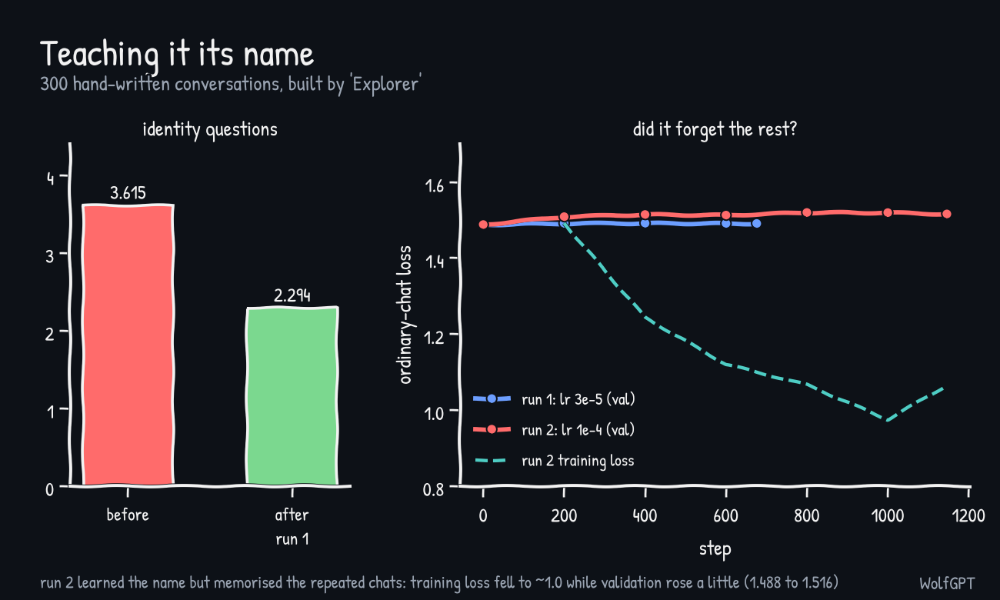

**Chat-time repetition fixes** (no retraining). With the identity stage, short messages ("OK") made it answer "I understand. I'm WolfGPT..." over and over. The chat code now scores each reply for repeated 4-token phrases, rejects replies above 0.3 and regenerates (warmer, then with less memory). Banning repeated 4-grams in an offline test took 112 repeated phrases to 0. A manual test with 3 retries gave "much better, perfect" for casual chat; what remains is content weakness, not loops.

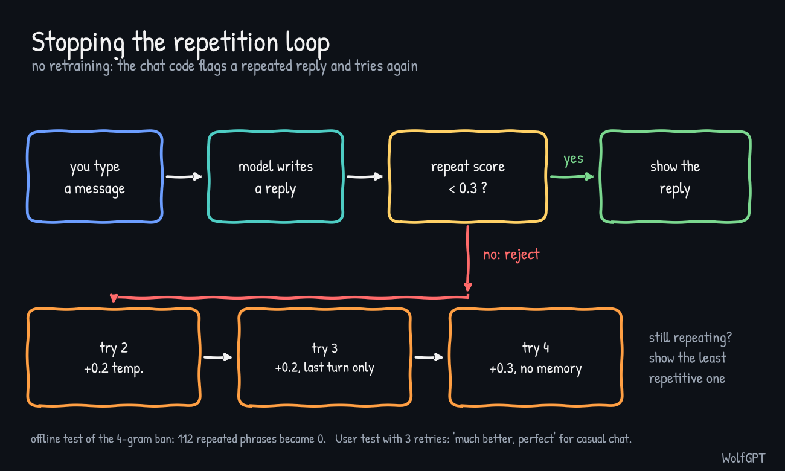

### Phase 6: benchmarks and release

Zero-shot, full test sets, scoring each answer by log-likelihood (accuracy normalised by length, except Winogrande). The script was checked against a one-by-one reference (difference 1e-5). Standard error is about 0.5 (HellaSwag) to 1.4 (Winogrande) points.


The base model beats random on HellaSwag, ARC-Easy and PIQA and is at chance on ARC-Challenge and Winogrande. SFT costs about 8 points on ARC-Easy and 3 on PIQA, partly because the tests use plain text rather than the chat format. An early 100-question run showed HellaSwag at 44%; that was small-sample noise (the full set gives 32.3%).

Where the GPU time went, about 26 hours in all:

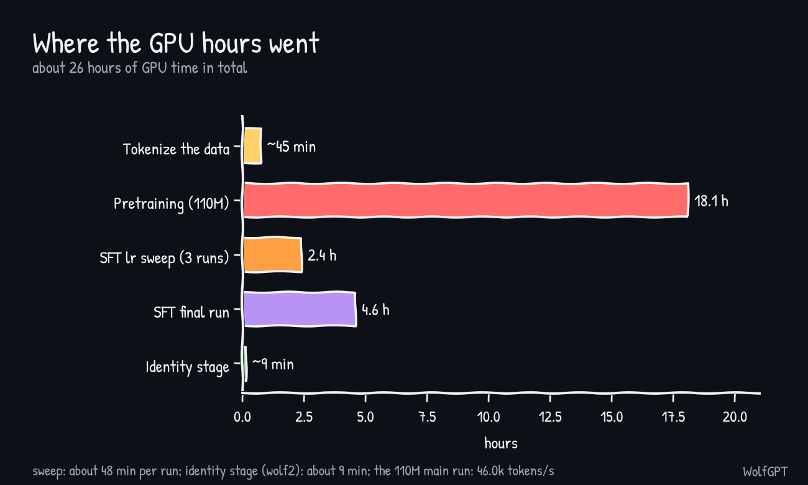

Release: the model is packaged as `Llama-WolfGPT-110M` (safetensors, a standalone `model.py` and `chat.py`, the Llama 3.1 licence, a NOTICE file and a model card with a "Built with Llama" notice). About 57% of the chat data (270,838 of 477,612 conversations) was written by Llama 3.1 405B, so the licence requires the Llama name and notice. No Llama weights or code were used. This is not legal advice; read the licence.


## What I learned

Each lesson says where it came from. "Measured" means a number from our own runs; "advice" means something we read or were told and did not test.

### About training

1. **Judge by validation loss, never training loss.** Measured in Phase 1: validation bottomed at 1.469 and rose to 1.679 while training fell to 0.625. Keep the best-validation checkpoint and stop after a few evaluations without improvement.
2. **Losses are only comparable on the same data and tokenizer.** The character-level numbers (1.4) and the BPE numbers (3.1) are not comparable.
3. **The optimizer mattered a lot at small scale.** Measured: Muon beat AdamW by 0.86 in loss in the 52M-token pilot, for about 4% less speed. Caveat: short pilots overstate gaps, and AdamW was only tried at two learning rates.
4. **Fix the code before the long run.** The independent review found real problems (data seen with repeats, a Muon update that favoured one block, a validation set that depended on batch size, no resume). Resume was tested to give bit-identical weights, and the main run was stopped and resumed once or more without trouble.
5. **Tokens per parameter.** 3.0B tokens for 110M parameters is about 27 tokens per parameter, above the 20 rule of thumb, with one pass over the data: validation kept falling to the end (no overfitting).
6. **Speed is mostly about not wasting the GPU.** torch.compile gave +38% speed and -38% memory in the pilot. The loss is summed on the GPU with one sync per step. Training reached 33.0 TFLOP/s, about two thirds of the matmul peak.
7. **Honest FLOP counting.** Causal attention does half the work, so counting it fully overstated speed by 8 to 10%.

### About fine-tuning (SFT)

8. **SFT teaches format, not knowledge.** After SFT the model greets, answers and stops, but facts stay unreliable.
9. **Mask the prompt, keep the end token.** Loss only on answer tokens, and the end-of-text token is part of the answer so the model learns to stop.
10. **Deduplicate before splitting** so validation copies are not in training. 20,213 repeated first prompts were removed.
11. **Drop, do not cut, over-long examples.** Cutting would delete the end token and teach the model that answers stop at random points.
12. **More different examples beats more passes over the same ones.** Overfitting comes from repetition. The final run saw 446k distinct chats twice; the second epoch added only 0.057.
13. **Sweep the learning rate on a shorter run.** 3e-4 won 1.630 vs 1.706 vs 1.761, but it was the highest tried, so the optimum may be higher.
14. **Validation loss does not show drift.** Read samples. Early sweep models looped ("Read the text" x15); the final one did not.
15. **Small targeted stages need a targeted metric.** The training script kept the checkpoint with the best overall validation loss, which is 98% ordinary chats, so it picked step 200, before the name was learned. For a small stage use the last checkpoint or measure the target.
16. **Repeating a tiny dataset many times has a price.** Identity chats x8 taught the name but also memorised them (training loss ~1.0, validation up 1.488 to 1.516) and made the model recite its identity to unrelated short messages. The root fix, not done, is more varied small-talk data and fewer identity copies.
17. **A model copies itself.** The chat history is in the prompt, so a small model repeats its own earlier replies; low temperature makes loops sticky.

### About generation

18. **Low temperature loops.** Measured on the base model: at 0.3 to 0.5 it repeated the same sentences and held wrong facts with confidence (water boils at 15 C). The useful range was about 0.7 to 0.9 with top-k 40 to 50 for the base model.
19. **Fix repetition at chat time before retraining.** Score replies for repeated 4-token phrases, reject and retry warmer, cut at the first "###". Offline: 112 repeated phrases to 0. The anti-repeat n-gram ban alone can make words odd when the model has nothing else to say, so it is optional.
20. **Typing into the wrong prompt.** A shell command pasted into a chat is just text to the model; it continues it. Nothing executes.

### About measuring

21. **Small samples lie.** 100 HellaSwag questions gave 44%; the full 10,042 gave 32.3%. Report the sample size and the standard error.
22. **Test your evaluation code** against a slow one-by-one reference (difference 1e-5).
23. **The honest result is mixed.** The base model is above chance on HellaSwag, ARC-Easy and PIQA, at chance on ARC-Challenge and Winogrande. SFT lowers plain-text scores by a few points. The base model is about equal to GPT-2 124M on HellaSwag (31.1 reported for GPT-2, different evaluation code, only roughly comparable).

### About data and licences

24. **Synthetic data inherits its generator's terms.** 57% of the chat conversations came from Llama 3.1 405B, so the model carries the Llama name, a "Built with Llama" notice, the licence and a NOTICE file. Dolly is CC BY-SA 3.0 and FineWeb-Edu is ODC-By: attribution is required. Not legal advice.
25. **Do not re-upload web text.** Link to the dataset card instead.
26. **Synthetic persona data makes small models invent stories.** Role-playing at the model ("I'm your father") made it invent a father named David.

### About working

27. **Secrets.** A Hugging Face token was pasted into a terminal log; it was revoked immediately. Use environment variables, keep `.env` out of git, and never paste tokens into chats or logs.
28. **Check what you delivered.** Files sent to the PC sometimes arrived as the previous version. The fix: wait, compare byte for byte.
29. **Run one command at a time.** Pasting a command while a chat is still open sends it to the model as a message.
30. **Documenting as you go is cheap, reconstructing later is not.** Every phase has a dated log; this repository is built from them.

### Ideas, not tested

Only advice or plans; nothing was built or measured.

- Training together with other PCs: ordinary data-parallel training needs fast links between machines, and internet links are far too slow. Low-communication methods (DiLoCo, OpenDiLoCo, INTELLECT-1) exist for that; a two-machine test is an idea.
- A polish round (about 150 varied small-talk chats, fewer identity copies, pick the checkpoint by an identity plus small-talk metric).
- Learning rate 5e-4 for SFT; scratchpad arithmetic with programmatically generated data; a retrieval (RAG) demo over the project notes; more pretraining tokens (the 10B sample) or a larger model (about 325M with context 2,048).
- A "thinking" model was asked about but not attempted.


## Final decisions

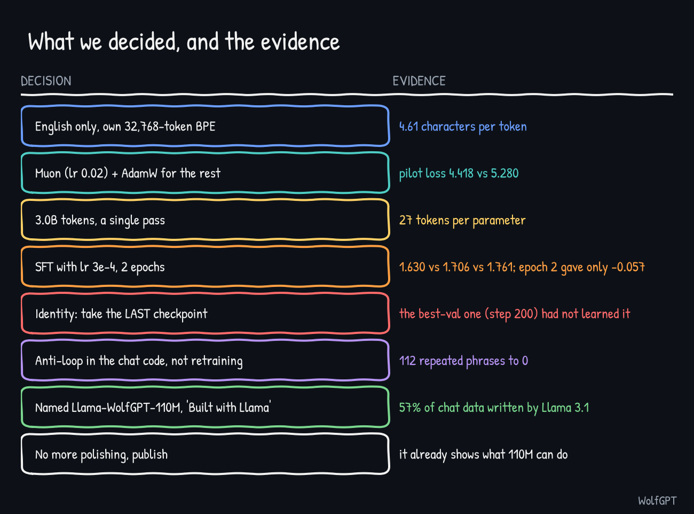

| # | Decision | Why (evidence) | Not tried |
|---|---|---|---|
| 1 | English-only model, own byte-level BPE tokenizer with 32,768 tokens | 4.61 characters per token; Portuguese public-domain text is pre-reform spelling | A Portuguese or bilingual model on modern text |
| 2 | FineWeb-Edu `sample-10BT`, 3.0B tokens, one pass | about 27 tokens per parameter (rule of thumb 20); validation kept falling to the end | The full 10B sample |
| 3 | Decoder-only GPT: 12 layers, 12 heads, width 768, context 1,024, tied embeddings, RoPE, RMSNorm, SwiGLU, no dropout. 110,119,680 parameters | fits a 16 GB card with room (6.5 GB at micro-batch 8); roughly 125M-class | About 325M with context 2,048 (a stretch for 16 GB); 1B does not fit |
| 4 | Muon (lr 0.02, weight decay 0) for hidden matrices, AdamW (lr 2e-3) for embeddings and norms | pilot loss 4.418 vs 5.280 for AdamW | Muon weight decay; more AdamW learning rates |
| 5 | Cosine decay to 10% of peak, warm-up 1% | worked: no spikes (largest gradient norm 2.28) | Decay to about zero |
| 6 | Chat format `### User:` / `### Assistant:` plus the end token, loss on answers only | the model greets, answers and stops | A different template |
| 7 | SFT mix: smol-smoltalk + everyday-conversations (x3) + Dolly, deduplicated, over-long examples dropped | 446,353 training conversations; validation 2.395 to 1.484 | Only human-written data |
| 8 | SFT learning rate 3e-4, 2 epochs | 1.630 vs 1.706 vs 1.761; epoch 2 added only 0.057 | 5e-4; 3 epochs |
| 9 | Teach the name with 300 hand-written chats (identity x8, lr 1e-4, 3 epochs) and use the **last** checkpoint | the best-validation checkpoint (step 200) had not learned the name | A gentler recipe with small-talk data |
| 10 | Fix repetition in the chat code: reject-and-retry (threshold 0.3, 3 retries), cut at "###", optional n-gram ban | offline 112 repeated phrases to 0; user test "much better, perfect" | Retraining with small-talk data |
| 11 | Evaluate zero-shot on five public benchmarks, full sets, and publish the weak numbers too | base model above chance on three of five | Few-shot, chat-format evaluation |
| 12 | Stop improving and publish: the project proved what 110M parameters can do | decided by the author after the benchmarks | The polish round |
| 13 | Name `Llama-WolfGPT-110M`, "Built with Llama", licence + NOTICE | 57% of the chat data was written by Llama 3.1 405B | Retraining without that data |
| 14 | Weights and model card on Hugging Face (private first), code and docs here on GitHub (private first), MIT licence for the code | weights are under the Llama 3.1 Community License, which does not cover the code | |

### How to read this

The decisions were made with the evidence available at the time. Several winners sit at the edge of what was tested (the SFT learning rate, Muon's learning rate against AdamW), so they are good choices, not proven optima. The last column lists what we did not try.


## Glossary

Plain-language definitions of the terms used while building WolfGPT, written as I learned them.

### Hardware and software

**GPU** - The graphics card. It does huge numbers of simple calculations at once, which is exactly what neural networks need. Ours: NVIDIA RTX 5060 Ti.

**VRAM** - The GPU's own memory (16 GB here). The model's weights, the data being processed and the training state must all fit in it. This is why a 1B-parameter model does not fit on this card.

**Tensor cores** - Special circuits on the GPU that multiply small blocks of numbers in a single step. The fast 16-bit speeds come from them.

**CUDA** - NVIDIA's software layer that lets programs run on the GPU.

**Compute capability / sm_120** - The GPU's architecture version. Ours is 12.0 (Blackwell). PyTorch must ship code compiled for it, which is why this project needs a CUDA 12.8+ build.

**WSL2** - Windows Subsystem for Linux 2: a real Linux running inside Windows. AI tools run on Linux, while still using the Windows GPU driver.

**venv (virtual environment)** - An isolated folder of Python packages for one project, so installs do not affect anything else. It must be activated in every new terminal (`source ~/wolfgpt-env/bin/activate`); the prompt then starts with (wolfgpt-env).

**PyTorch** - The Python library used to build and train neural networks on the GPU.

**torch.compile** - PyTorch's compiler for the model. In the pilot it gave +38% speed and -38% memory.

### Math and speed

**Matrix / matmul (matrix multiplication)** - A matrix is a grid of numbers. Multiplying two grids means: for each cell of the result, multiply a row of one by a column of the other and add it up. A GPT is mostly matmuls repeated billions of times, which is why we benchmark them.

**FLOP** - One arithmetic operation (one multiply or one add). Multiplying two N x N matrices costs about 2 x N^3 FLOPs.

**TFLOP/s** - Trillions of FLOPs per second. Our measured bf16 speed is about 50 TFLOP/s.

**Number formats**
- **fp32** - 32 bits per number. Precise but slow.
- **fp16** - 16 bits. Faster and half the memory, but a narrow range of sizes, so it can overflow.
- **bf16** - 16 bits with the same range as fp32 but less detail. Rarely overflows, so it is our training format.
- **TF32** - fp32 inputs rounded during the multiply. About half the speed of bf16 here.

**MFU (model FLOPs utilization)** - The share of the benchmarked peak that real training uses. Training also moves data and does other math, so 30-50% is typical. WolfGPT's main run used about two thirds (33.0 of about 50 TFLOP/s).

### The model

**Parameters (the "110M")** - The learned numbers inside the model. 110M means 110 million of them (110,119,680 exactly). More data never adds parameters; only a different model shape does.

**Weights** - Another word for the parameters. Training adjusts them.

**Token** - A chunk of text, roughly three-quarters of a word. "Tokens per second" is how fast training reads text.

**Tokenizer / BPE** - The program that cuts text into tokens. Byte-level BPE (byte-pair encoding) builds its vocabulary (32,768 tokens here) by repeatedly merging the most frequent pairs of bytes.

**Context window (context length)** - How many tokens the model can look at at once. WolfGPT: 1,024. Anything longer does not fit, and the model was only trained on positions up to 1,024.

**GPT** - Generative Pre-trained Transformer: a model trained to predict the next token.

**Attention, RoPE, RMSNorm, SwiGLU, tied embeddings** - Attention lets each token look at earlier tokens. RoPE tells attention where each token is. RMSNorm keeps the numbers in a stable range between layers. SwiGLU is a gated feed-forward layer (half of WolfGPT's parameters are in it). Tied embeddings means the word table at the input and the one at the output are the same numbers.

**Perplexity** - e raised to the loss: roughly, among how many words the model is torn at each step. WolfGPT's base model: about 22.8.

**Training** - Repeatedly showing the model text, measuring how wrong its next-token guesses are (the loss), and nudging the weights to be less wrong.

### How training is organised

**Epoch** - One full pass over the whole training dataset. Pretraining was less than one epoch (each of the 3B tokens seen about once). SFT uses 2 epochs. More passes help learning at first, but too many make the model memorize the examples (overfitting). Many different examples seen once or twice is safer than few examples seen many times.

**Step, batch, micro-batch** - A step is one update of the weights. A batch is the group of examples used for that update (32 conversations in SFT). A micro-batch is the slice that fits on the GPU at once; the results of several slices are added up before the update (gradient accumulation). In SFT the slices are sized by tokens (4,096), not by number of conversations.

**Padding** - Filler tokens added to short examples so every example in a batch has the same length. They are ignored in the loss.

**Optimizer (AdamW, Muon)** - The rule for how to update the weights from the gradient. AdamW is the usual choice. Muon is newer and is used for the hidden matrices; in the pilot it reached a loss of 4.418 against 5.280 for AdamW.

**Learning rate** - The size of each weight update. Too high: unstable training or forgetting what the model knew. Too low: slow. **Warm-up**: start small and ramp up over the first steps. **Cosine decay**: lower it smoothly, here to 10% of the peak by the end. A **learning-rate sweep** tries several values on a shorter run and keeps the best.

**Gradient clipping / gradient norm** - Limiting the size of a single update. A spike in the gradient norm warns that training is becoming unstable (the largest seen in the main run was 2.28: no spikes).

**Training loss vs validation loss** - Training loss is measured on data the model learns from; validation loss on held-out data it never trains on. Validation is the honest number.

**Overfitting** - Training loss keeps falling while validation loss stops improving or rises: the model is memorizing instead of learning (seen in Phase 1, within minutes). Keeping the best-validation checkpoint guards against it.

**Checkpoint** - A saved snapshot of the model (and optionally the optimizer and data position) so training can resume after a crash.

**Resume snapshot** - A checkpoint that also stores the optimizer state, the random-number state and the position in the data, so an interrupted run continues exactly where it stopped and ends with the same weights. Re-running run_overnight.sh uses it automatically.

**Smoke test** - A tiny run (about 20 steps) that checks everything works before starting the long run.

### Data

**Deduplication** - Removing repeated examples. Needed so a copy of a validation example is not also in the training data.

**Data leakage** - When validation examples (or copies of them) are seen during training, so the validation loss looks better than the model really is.

**Dropped conversations** - In SFT data prep, conversations whose first question and answer together exceed 1,024 tokens are removed (about 2%). Cutting them would delete the end of the answer, including the end-of-text token, and teach the model that answers stop at random points. Later turns of a multi-turn chat that do not fit are cut off whole.

**System message** - An instruction given to the model before the user's message (for example "summarize in one sentence"). We keep it only for the rewrite and summarize subsets, where the task lives in it.

**Synthetic data** - Training text written by another AI model instead of by humans. Cheap and plentiful, but it inherits that model's mistakes and style, and its terms of use. smol-smoltalk is synthetic; Dolly is human-written.

**Magpie** - A method for making synthetic instruction data. A chat model is given only the start of a user turn (the template that normally comes before a question), so it invents the question itself; then a model answers it. This yields huge, varied question sets without writing prompts by hand. magpie-ultra was made this way with Llama 3.1 405B-Instruct; **smol-magpie-ultra** is the shorter-conversation version prepared for models under 1B parameters, and it is the biggest part of smol-smoltalk (57% of the mix). Because the text comes from Llama, its licence terms apply to WolfGPT.

**Upsampling / repetition of a small source** - Showing a small but important source several times (here the everyday-conversation greetings, x3, in training only) so it is not drowned out by 450k other chats. Validation is never repeated.

### Making the model useful

**Base model** - A model that only continues text (what WolfGPT is after Phase 4). It does not answer questions or chat.

**Fine-tuning** - Continuing to train an already trained model on a smaller, targeted dataset, so its weights change. Best for changing behavior and format, not for adding many reliable facts. Like teaching a student a skill.

**SFT (supervised fine-tuning)** - Fine-tuning on example conversations (a question and the answer we want). This is Phase 5: it turns the base model into a chat model.

**Loss masking** - In SFT, only the answer tokens count toward the loss; the user's question is given to the model but not scored, so it learns to answer rather than to imitate questions.

**Chat template** - The fixed text layout of a conversation ("### User: ... ### Assistant: ..."), plus an end-of-text token that tells the model when its answer is finished.

**Identity stage** - A short extra fine-tuning on hand-written conversations that teach the model its name and who built it. Repeating a tiny dataset many times taught the name but also made the model memorize it and recite it at unrelated short messages.

**LoRA** - A cheaper fine-tuning method that trains only small add-on layers instead of all the weights. Saves memory; not needed here because the whole 110M model fits on the GPU.

**RAG (retrieval-augmented generation)** - At question time, search a document collection, paste the best passages into the prompt, and let the model answer from them. The model is not retrained, so facts can be changed by editing the documents. Like an open-book exam. Limited here by the 1,024-token context and the small model's weak reading. An idea, not built.

**Hallucination** - Fluent text that states invented facts. WolfGPT does this often at 110M parameters (the 3,800 heart cells, the boiling point of 15 degrees).

### Sampling (how text is generated)

**Temperature** - Controls randomness when picking the next word. Low (0.3): always the safest word, which causes loops. High (1.0+): more varied but more nonsense. 0.7-0.9 works best for the base model.

**Top-k** - Only choose among the k most likely next words (we use 40-50), which cuts out very unlikely words.

**Repetition penalty** - A sampling setting that lowers the score of words already used in the answer, which reduces loops. Ours is a fixed subtraction, off by default.

**No-repeat n-gram ban** - Forbid generating a phrase of N tokens that already appeared. It removed all repeated 4-token phrases in an offline test, but can produce odd words when the model has nothing else to say.

**Reject-and-retry** - After each reply, score how much of it repeats earlier replies; if it is above a threshold (0.3), throw it away and generate again, a bit warmer and with less memory. No retraining needed.

### Evaluation

**Zero-shot** - Tested with no examples in the prompt. **Benchmark** - A public test set with known answers.

**HellaSwag, ARC-Easy, ARC-Challenge, PIQA, Winogrande** - Multiple-choice common-sense and science tests. The model scores each answer text by log-likelihood and picks the best. Random guessing gives 25% on the first three and 50% on the last two.

**acc / acc_norm** - Accuracy, and accuracy with each answer's score divided by its length (so long answers are not punished).

**Standard error** - How much a score would wobble with a different sample of questions. About 0.5 points on HellaSwag and 1.4 on Winogrande.

### Licences

**Llama 3.1 Community License** - If outputs of Llama are used to train a model that is distributed, the model's name must begin with "Llama", show "Built with Llama", and include the licence and a NOTICE file. Not legal advice.

**ODC-By, CC BY-SA** - Licences that require attribution (and, for CC BY-SA, sharing under the same terms). FineWeb-Edu is ODC-By; Dolly is CC BY-SA 3.0.

**safetensors** - A safe file format for model weights (unlike pickle files, it cannot run code when loaded).


## Repository map

| Folder / file | What it is |
|---|---|
| `01_install_ubuntu.ps1`, `02_setup_env.sh`, `03_run_ai.ps1`, `benchmark.py` | Phase 0: WSL2 + Ubuntu setup, Python environment, GPU benchmark, launcher script |
| `phase1/` | Phase 1: a tiny character-level GPT written by hand |
| `phase2/` | Phase 2: tokenizer training and tokenizing the FineWeb-Edu sample |
| `phase3/` | Phases 3-4: model, Muon optimizer, training, pilot and main runs, sampling, code-review fixes |
| `phase5/` | Phases 5-6: chat data prep, SFT, chat, benchmarks, release export, model card |
| `docs/` | The written record: journey, learnings, decisions, glossary, phase logs, infographics (`docs/img/`), Portuguese versions (`docs/pt-BR/`) |
| `make_figures.py` | Draws the infographics from the run files (`python make_figures.py --data . --out docs/img`) |
| `LOG.md`, `GLOSSARY.md` | Early running log and glossary (the full versions are in `docs/`) |

Large files (datasets, checkpoints, model weights) are **not** in this repository: see `.gitignore`. The weights are on Hugging Face.


## Reproducing it (outline)

Hardware used: one 16 GB NVIDIA GPU (Blackwell, `sm_120` needs a PyTorch build for CUDA 12.8 or newer), Windows 11 + WSL2 Ubuntu. Python packages: see `requirements.txt`.

1. Environment and GPU benchmark: Phase 0 scripts; details in `docs/JOURNEY.md`.
2. Data and tokenizer (Phase 2), then pilot and main pretraining (`phase3/run_pilot.sh`, `phase3/run_main.sh`).
3. Chat fine-tuning, from `phase5/`:
   ```
   python prep_sft.py          # download and prepare ~457k conversations
   bash run_overnight.sh       # learning-rate sweep, then the full run (resumable)
   python prep_identity.py --val_orig 980 --id_rep 8 --out ~/wolfgpt-data/sft_id2
   python sft.py --base ~/wolfgpt-data/ckpt/final_best.pt --data_dir ~/wolfgpt-data/sft_id2 --tag wolf2 --lr 1e-4 --epochs 3
   ```
4. Chat: `python chat.py --ckpt ~/wolfgpt-data/ckpt/wolf2_last.pt --temperature 0.4 --rep_penalty 0.3 --retries 3`
5. Benchmarks: `python eval_bench.py --ckpt <checkpoints>`; release folder: `python export_release.py`.

Paths such as `~/wolfgpt-data/` are where the author kept data and checkpoints on the Linux side of WSL; change them as needed.


## Licences and data

- **Code:** see `LICENSE` in the repository root.
- **Model:** built with Llama. Part of the fine-tuning conversations (the Smol-Magpie-Ultra subset of smol-smoltalk, about 57% of the mix) was generated with Llama-3.1-405B-Instruct, so the model is released under the **Llama 3.1 Community License** and named "Llama-WolfGPT-110M". No Llama weights or code were used: WolfGPT was pretrained from scratch. See `phase5/MODEL_CARD.md`.
- **Data:** FineWeb-Edu (pretraining), smol-smoltalk and everyday-conversations (HuggingFaceTB), Databricks Dolly 15k (CC BY-SA 3.0), plus 300 hand-written identity conversations. Each dataset keeps its own licence; check them before reusing the model or data commercially.
- Infographic font: Patrick Hand (SIL Open Font License), not included in the repository.
- This is a good-faith summary, not legal advice.


## Acknowledgements

Muon optimizer (Keller Jordan et al.), the FineWeb-Edu dataset and the SmolLM / smol-smoltalk work at Hugging Face, the Magpie data method, and Meta's Llama 3.1 (whose outputs are in the fine-tuning data).

