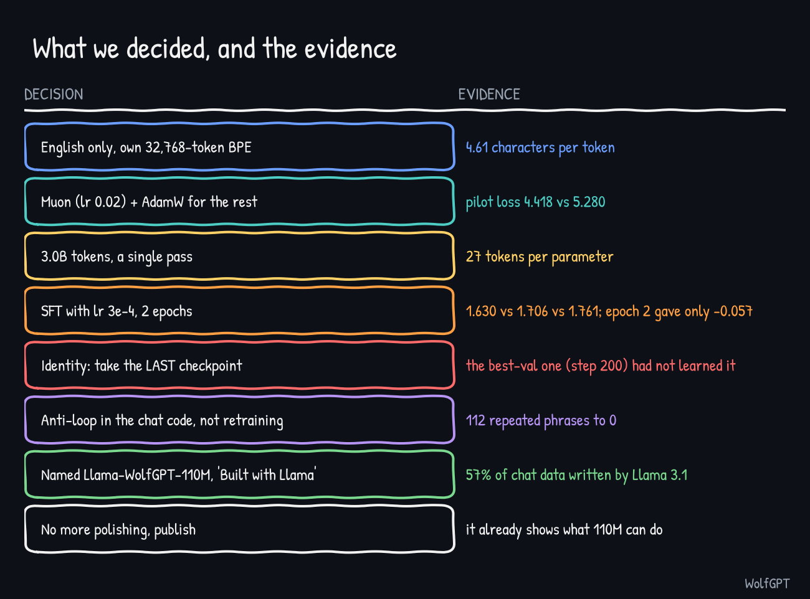

# Final decisions

Português: [pt-BR/DECISOES.md](pt-BR/DECISOES.md)

| # | Decision | Why (evidence) | Not tried |
|---|---|---|---|
| 1 | English-only model, own byte-level BPE tokenizer with 32,768 tokens | 4.61 characters per token; Portuguese public-domain text is pre-reform spelling | A Portuguese or bilingual model on modern text |
| 2 | FineWeb-Edu `sample-10BT`, 3.0B tokens, one pass | about 27 tokens per parameter (rule of thumb 20); validation kept falling to the end | The full 10B sample |
| 3 | Decoder-only GPT: 12 layers, 12 heads, width 768, context 1,024, tied embeddings, RoPE, RMSNorm, SwiGLU, no dropout. 110,119,680 parameters | fits a 16 GB card with room (6.5 GB at micro-batch 8); roughly 125M-class | About 325M with context 2,048 (a stretch for 16 GB); 1B does not fit |
| 4 | Muon (lr 0.02, weight decay 0) for hidden matrices, AdamW (lr 2e-3) for embeddings and norms | pilot loss 4.418 vs 5.280 for AdamW | Muon weight decay; more AdamW learning rates |
| 5 | Cosine decay to 10% of peak, warm-up 1% | worked: no spikes (largest gradient norm 2.28) | Decay to about zero |
| 6 | Chat format `### User:` / `### Assistant:` plus the end token, loss on answers only | the model greets, answers and stops | A different template |
| 7 | SFT mix: smol-smoltalk + everyday-conversations (x3) + Dolly, deduplicated, over-long examples dropped | 446,353 training conversations; validation 2.395 to 1.484 | Only human-written data |
| 8 | SFT learning rate 3e-4, 2 epochs | 1.630 vs 1.706 vs 1.761; epoch 2 added only 0.057 | 5e-4; 3 epochs |
| 9 | Teach the name with 300 hand-written chats (identity x8, lr 1e-4, 3 epochs) and use the **last** checkpoint | the best-validation checkpoint (step 200) had not learned the name | A gentler recipe with small-talk data |
| 10 | Fix repetition in the chat code: reject-and-retry (threshold 0.3, 3 retries), cut at "###", optional n-gram ban | offline 112 repeated phrases to 0; user test "much better, perfect" | Retraining with small-talk data |
| 11 | Evaluate zero-shot on five public benchmarks, full sets, and publish the weak numbers too | base model above chance on three of five | Few-shot, chat-format evaluation |
| 12 | Stop improving and publish: the project proved what 110M parameters can do | decided by the author after the benchmarks | The polish round |
| 13 | Name `Llama-WolfGPT-110M`, "Built with Llama", licence + NOTICE | 57% of the chat data was written by Llama 3.1 405B | Retraining without that data |
| 14 | Weights and model card on Hugging Face (private first), code and docs here on GitHub (private first), MIT licence for the code | weights are under the Llama 3.1 Community License, which does not cover the code | |

## How to read this

The decisions were made with the evidence available at the time. Several winners sit at the edge of what was tested (the SFT learning rate, Muon's learning rate against AdamW), so they are good choices, not proven optima. The last column lists what we did not try.

See also: [journey](JOURNEY.md), [what I learned](LEARNINGS.md).
