# The journey, phase by phase

Português: [pt-BR/JORNADA.md](pt-BR/JORNADA.md)

Every number below was measured during the project (run logs in `phase3/runs/`, `phase5/runs/`, `phase5/eval_results.json`, `benchmark_result.json`) or counted from the code. Figures are drawn by `make_figures.py` from those files.

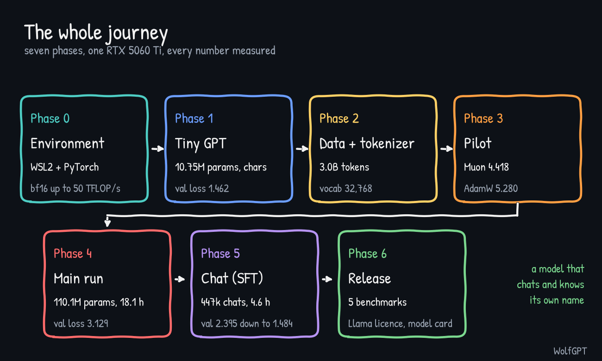

## Phase 0: environment

WSL2 + Ubuntu on Windows 11, Python virtual environment on the Linux disk (not `/mnt/c`, which is slow), PyTorch 2.11 built for CUDA 12.8. The GPU is Blackwell (compute capability 12.0, `sm_120`), so an older PyTorch build would not work. The NVIDIA Windows driver (621.14) was already new enough (570 or newer is required).

Measured matrix-multiply speed (median of 50 multiplications, two runs agreeing within about 2%): bf16 47.4 to 50.1 TFLOP/s, fp16 48.7 to 49.9, tf32 24.2 to 25.1. Training later reached 33.0 TFLOP/s, about two thirds of the bf16 peak.

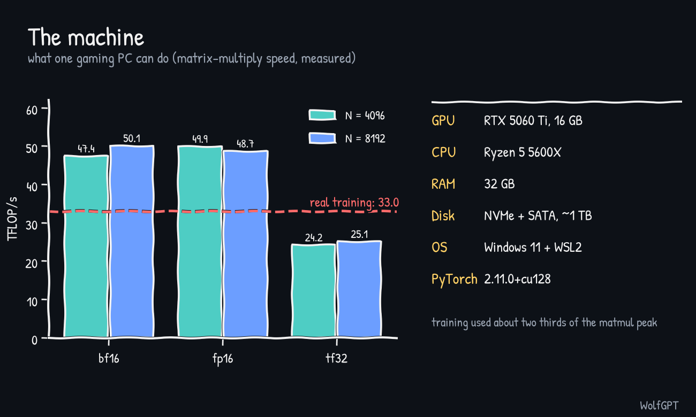

Tip that mattered: close other programs before long runs. They held 3.4 GB of VRAM.

## Phase 1: a tiny GPT by hand

Two 10.75M-parameter character-level GPTs (6 layers, 6 heads, width 384, context 256), one on tiny Shakespeare (English) and one on Machado de Assis (Portuguese). Best validation loss 1.462 (English) and 1.379 (Portuguese), reached after about three minutes of training. The English sample had speaker names and verse; the Portuguese one wrote 1800s-style Portuguese with broken grammar.

Without early stopping the validation loss bottomed at 1.469 and then rose to 1.679 while the training loss kept falling to 0.625. That is overfitting, seen within minutes. The Portuguese model also copied character names from its roughly 1 MB of text (memorisation).

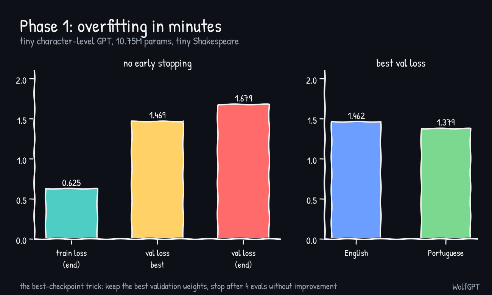

## Phase 2: data and tokenizer

English only for the main model (Portuguese public-domain text is pre-reform spelling, so a Portuguese model needs modern text first). Data: FineWeb-Edu `sample-10BT`, streamed, split by document order: 100k documents for the tokenizer, 10k for validation, the rest for training.

The tokenizer is a byte-level BPE with 32,768 tokens, trained in 57 seconds. It averages 4.61 characters per token on unseen text (the Phase 1 character model has 1.00). Tokenizing gave 3,002,016,685 training tokens and 10,032,689 validation tokens, about 45 minutes at roughly 1.1M tokens/s.

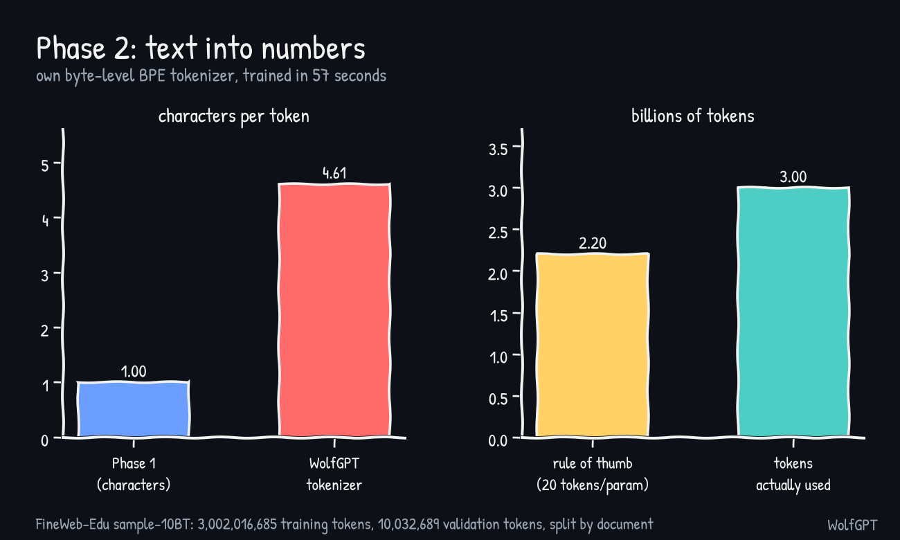

## Phase 3: the pilot, Muon vs AdamW

A 47.9M-parameter model (10 layers, 8 heads, width 512), 400 steps of 131,072 tokens (52M tokens), same data order and the same fixed validation set in every run. Before the pilot, an independent code review found and fixed several bugs (see [PHASE3_FIXES.md](../phase3/PHASE3_FIXES.md)), so the pilot was run on the corrected code.

Muon with lr 0.02 reached 4.418, Muon with lr 0.05 reached 4.537, AdamW with lr 6e-4 reached 5.280 and AdamW with lr 2e-3 reached 5.352. Muon was 0.86 lower (perplexity about 2.4 times lower) for about 4% less speed. Caveats: only 52M tokens (the gap shrinks in long runs), and the AdamW grid had only two points, with the better one at the lower end.

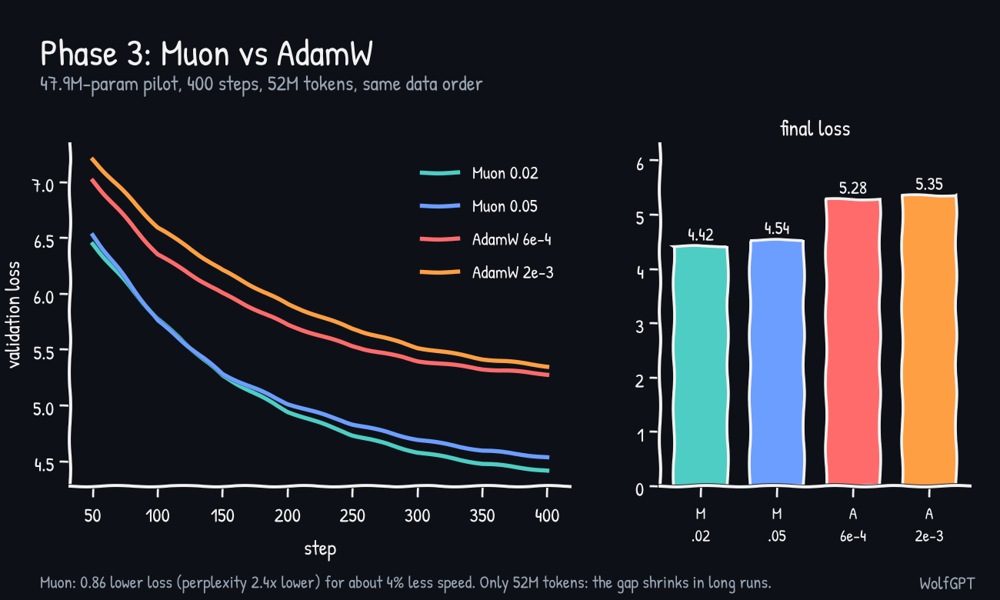

## Phase 4: the main run

The model: 110,119,680 parameters (12 layers, 12 heads, width 768, context 1,024, vocabulary 32,768), with tied input/output embeddings, RoPE, RMSNorm and a SwiGLU feed-forward. Half of the numbers live in the feed-forward layers.

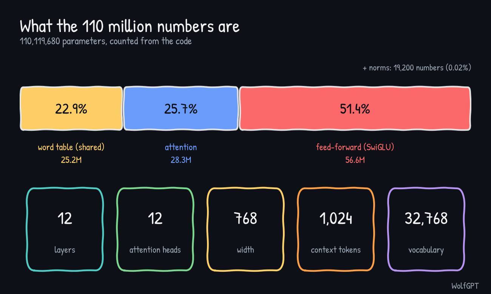

Training: Muon (lr 0.02) on the hidden matrices plus AdamW (lr 2e-3) on embeddings and norms, 22,888 steps of 131,072 tokens (3.0B tokens, a single shuffled pass), bf16, `torch.compile`. It ran at 46.0k tokens/s and 33.0 TFLOP/s, peak memory 6.5 GB, 18.1 hours. The run was stopped and resumed at least once, and the resume code worked.

Validation loss: 10.57 at step 0, 4.22 at step 500, 3.60 at step 2,500, 3.28 at step 10,000 and 3.129 at the end (perplexity about 22.8). The largest gradient norm seen at any evaluation was 2.28, so there were no spikes. Validation loss kept falling to the very end, so there was no overfitting.

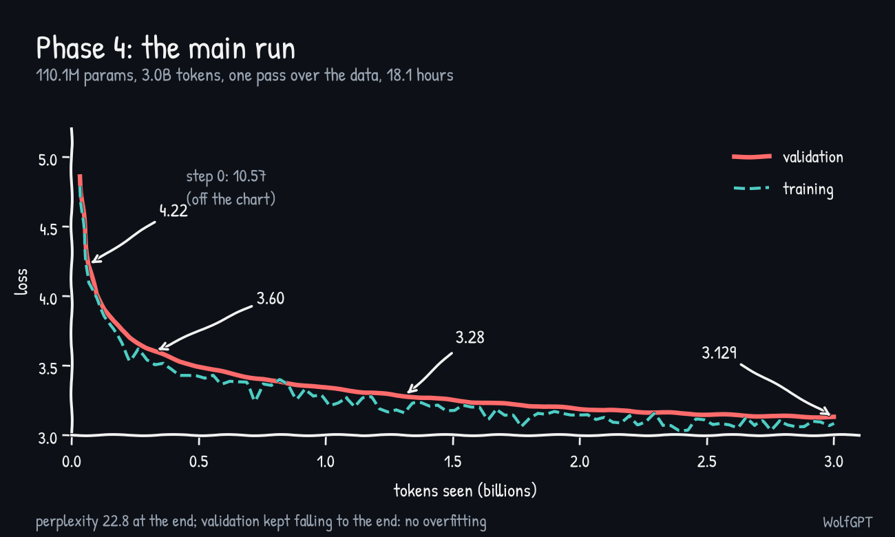

The base model is fluent but unreliable: it invents facts ("water boils at 15 degrees"), loops at low temperature and treats "hello" as the start of an article. That is expected for 110M parameters and 3B tokens.

## Phase 5: chat (SFT) and identity

Data: smol-smoltalk (about 460k synthetic chats), everyday-conversations (greetings, repeated 3 times in training only) and Dolly 15k (human-written), 477,612 conversations in total. After removing repeated first prompts and conversations whose first exchange exceeds 1,024 tokens, 446,353 training conversations (267.5M tokens, 77% of them answer tokens) and 1,000 validation conversations remained. Loss is computed on answer tokens only.

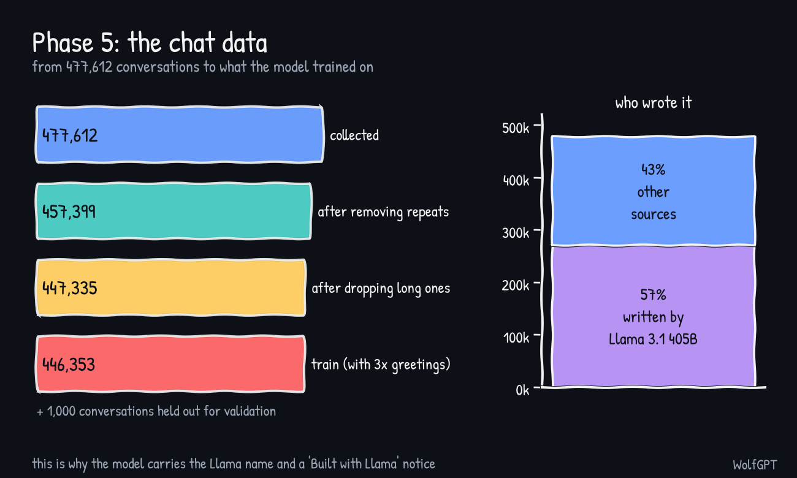

Learning-rate sweep (1 epoch on a 150k subset, about 48 minutes each): 5e-5 gave 1.761, 1e-4 gave 1.706 and 3e-4 gave 1.630 (the base model was 2.395). The winner is the highest value tried, so a higher rate might do better; that was not tested.

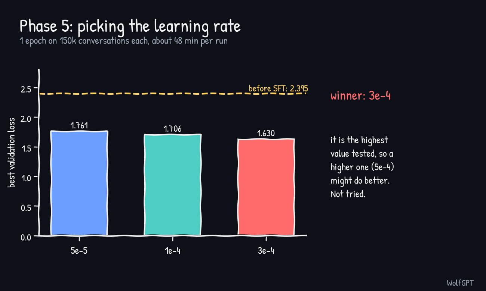

Final run: lr 3e-4, 2 epochs, 27,896 steps, 4.6 hours at 33.3k tokens/s. Validation loss 2.395 to 1.484. Epoch 1 ended at 1.541 and epoch 2 added only 0.057. Human-written Dolly text has the highest loss of any source and code the lowest.

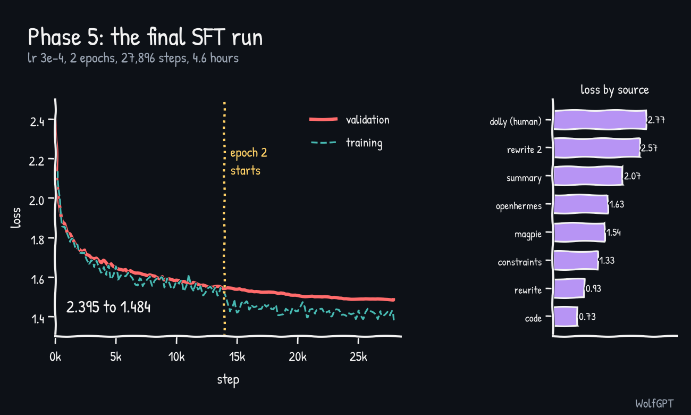

**Identity.** The model had no idea who it was and invented a father called David. A Haiku agent wrote 300 short conversations, which were reviewed (name WolfGPT, a small language model of about 110M parameters, built by "Explorer"). Run 1 (lr 3e-5, identity copies x3) was too gentle: identity loss 3.615 to 2.294, name still garbled. Run 2 (lr 1e-4, copies x8) learned the name but memorised the repeated chats: training loss fell to about 1.0 while ordinary-chat validation rose from 1.488 to 1.516. The best-validation checkpoint (step 200) was from before the name was learned, so the end-of-training checkpoint `wolf2_last.pt` is the demo model.

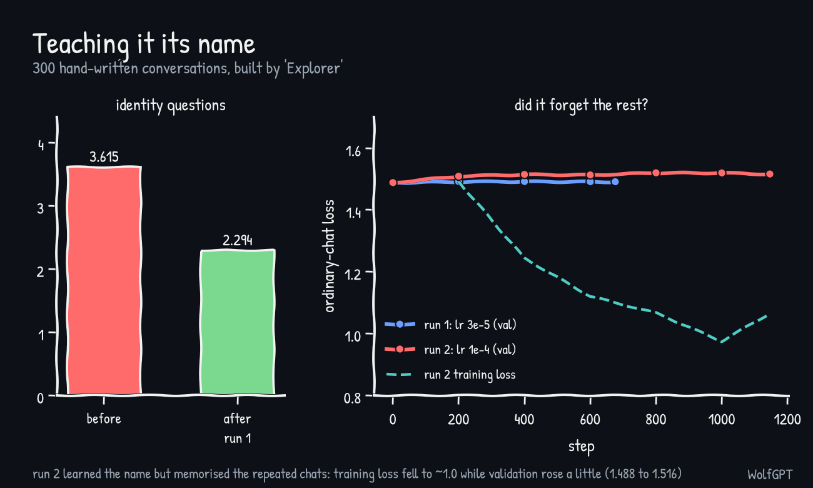

**Chat-time repetition fixes** (no retraining). With the identity stage, short messages ("OK") made it answer "I understand. I'm WolfGPT..." over and over. The chat code now scores each reply for repeated 4-token phrases, rejects replies above 0.3 and regenerates (warmer, then with less memory). Banning repeated 4-grams in an offline test took 112 repeated phrases to 0. A manual test with 3 retries gave "much better, perfect" for casual chat; what remains is content weakness, not loops.

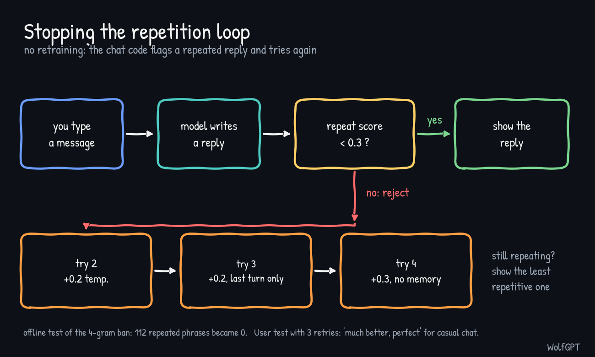

## Phase 6: benchmarks and release

Zero-shot, full test sets, scoring each answer by log-likelihood (accuracy normalised by length, except Winogrande). The script was checked against a one-by-one reference (difference 1e-5). Standard error is about 0.5 (HellaSwag) to 1.4 (Winogrande) points.

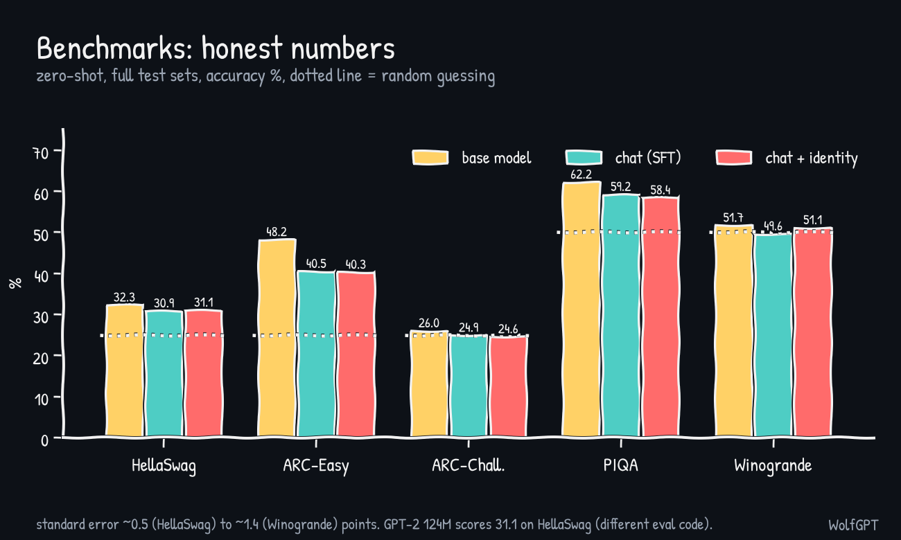

The base model beats random on HellaSwag, ARC-Easy and PIQA and is at chance on ARC-Challenge and Winogrande. SFT costs about 8 points on ARC-Easy and 3 on PIQA, partly because the tests use plain text rather than the chat format. An early 100-question run showed HellaSwag at 44%; that was small-sample noise (the full set gives 32.3%).

Where the GPU time went, about 26 hours in all:

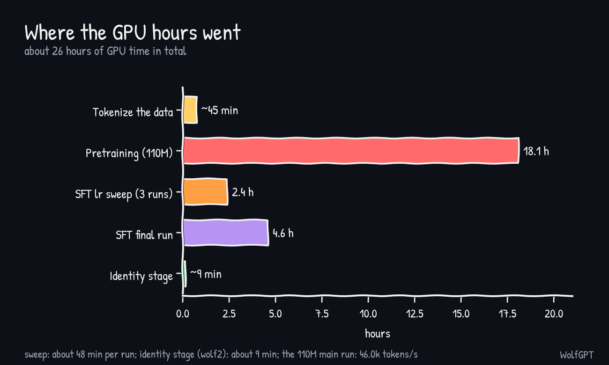

Release: the model is packaged as `Llama-WolfGPT-110M` (safetensors, a standalone `model.py` and `chat.py`, the Llama 3.1 licence, a NOTICE file and a model card with a "Built with Llama" notice). About 57% of the chat data (270,838 of 477,612 conversations) was written by Llama 3.1 405B, so the licence requires the Llama name and notice. No Llama weights or code were used. This is not legal advice; read the licence.

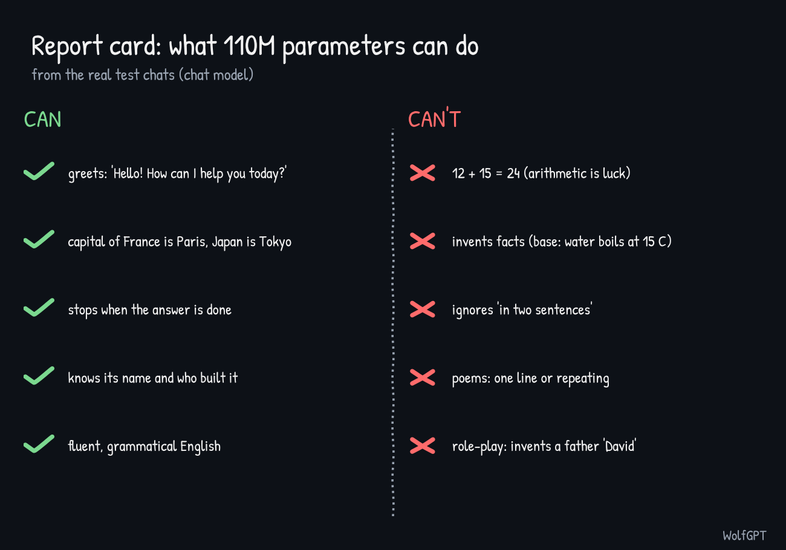

Next: [what we learned](LEARNINGS.md) and [the decisions](DECISIONS.md).
