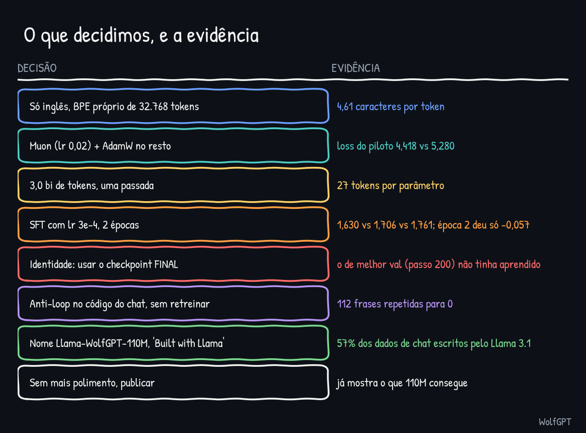

# Decisões finais

English: [../DECISIONS.md](../DECISIONS.md)

| # | Decisão | Por quê (evidência) | Não testado |
|---|---|---|---|
| 1 | Modelo só em inglês, tokenizer BPE de bytes próprio com 32.768 tokens | 4,61 caracteres por token; texto em português de domínio público usa a ortografia anterior à reforma | Um modelo em português ou bilíngue com texto moderno |
| 2 | FineWeb-Edu `sample-10BT`, 3,0 bi de tokens, uma passada | cerca de 27 tokens por parâmetro (regra prática 20); a validação caiu até o fim | A amostra completa de 10B |
| 3 | GPT só decodificador: 12 camadas, 12 cabeças, largura 768, contexto 1.024, embeddings compartilhados, RoPE, RMSNorm, SwiGLU, sem dropout. 110.119.680 parâmetros | cabe numa placa de 16 GB com folga (6,5 GB com micro-lote 8); classe de cerca de 125M | Cerca de 325M com contexto 2.048 (no limite dos 16 GB); 1B não cabe |
| 4 | Muon (lr 0,02, weight decay 0) nas matrizes internas, AdamW (lr 2e-3) em embeddings e normalizações | loss do piloto 4,418 contra 5,280 do AdamW | Weight decay no Muon; mais learning rates no AdamW |
| 5 | Decaimento cosseno até 10% do pico, aquecimento de 1% | funcionou: sem picos (maior norma de gradiente 2,28) | Decair até quase zero |
| 6 | Formato de chat `### User:` / `### Assistant:` mais o token de fim, loss só nas respostas | o modelo cumprimenta, responde e para | Outro formato |
| 7 | Mistura de SFT: smol-smoltalk + everyday-conversations (x3) + Dolly, sem duplicatas, exemplos longos descartados | 446.353 conversas de treino; validação de 2,395 para 1,484 | Só dados escritos por humanos |
| 8 | Learning rate de SFT 3e-4, 2 épocas | 1,630 contra 1,706 e 1,761; a época 2 acrescentou só 0,057 | 5e-4; 3 épocas |
| 9 | Ensinar o nome com 300 chats escritos à mão (identidade x8, lr 1e-4, 3 épocas) e usar o **último** checkpoint | o de melhor validação (passo 200) não tinha aprendido o nome | Uma receita mais suave com conversa casual |
| 10 | Resolver a repetição no código do chat: rejeitar e tentar de novo (limite 0,3, 3 tentativas), cortar em "###", proibição de n-gramas opcional | offline 112 frases repetidas para 0; teste do usuário "muito melhor, perfeito" | Retreinar com dados de conversa casual |
| 11 | Avaliar zero-shot em cinco benchmarks públicos, conjuntos completos, e publicar também os números fracos | modelo base acima do acaso em três de cinco | Few-shot, avaliação no formato de chat |
| 12 | Parar de melhorar e publicar: o projeto provou o que 110M de parâmetros conseguem | decidido pelo autor depois dos benchmarks | A rodada de polimento |
| 13 | Nome `Llama-WolfGPT-110M`, "Built with Llama", licença + NOTICE | 57% dos dados de chat foram escritos pelo Llama 3.1 405B | Retreinar sem esses dados |
| 14 | Pesos e model card no Hugging Face (privado primeiro), código e docs aqui no GitHub (privado primeiro), licença MIT para o código | os pesos seguem a Llama 3.1 Community License, que não cobre o código | |

## Como ler isto

As decisões foram tomadas com a evidência disponível na hora. Várias vencedoras estão no limite do que foi testado (a learning rate do SFT, a do Muon contra o AdamW), então são boas escolhas, não ótimos provados. A última coluna lista o que não tentamos.

Veja também: [jornada](JORNADA.md), [o que eu aprendi](APRENDIZADOS.md).
