# A jornada, fase por fase

English: [../JOURNEY.md](../JOURNEY.md)

Todos os números abaixo foram medidos durante o projeto (logs de execução em `phase3/runs/`, `phase5/runs/`, `phase5/eval_results.json`, `benchmark_result.json`) ou contados a partir do código. As figuras são desenhadas por `make_figures.py` a partir desses arquivos.

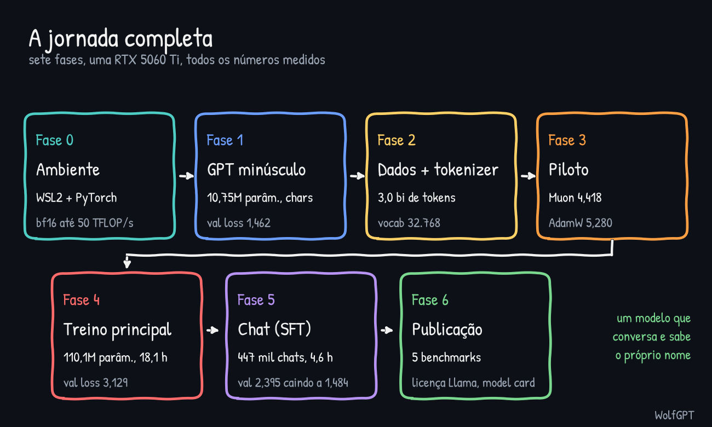

## Fase 0: ambiente

WSL2 + Ubuntu no Windows 11, ambiente virtual Python no disco do Linux (não em `/mnt/c`, que é lento) e PyTorch 2.11 compilado para CUDA 12.8. A GPU é Blackwell (capacidade de computação 12.0, `sm_120`), então um PyTorch mais antigo não funcionaria. O driver NVIDIA do Windows (621.14) já era novo o bastante (é preciso 570 ou mais).

Velocidade medida de multiplicação de matrizes (mediana de 50 multiplicações, duas rodadas concordando em cerca de 2%): bf16 de 47,4 a 50,1 TFLOP/s, fp16 de 48,7 a 49,9 e tf32 de 24,2 a 25,1. O treino depois chegou a 33,0 TFLOP/s, cerca de dois terços do pico de bf16.

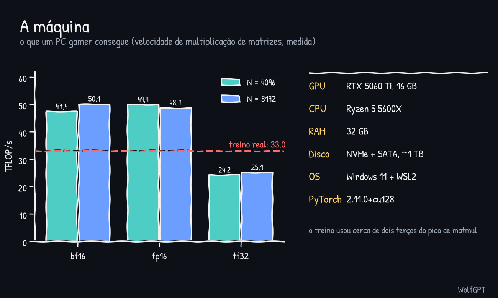

Dica que fez diferença: feche outros programas antes de treinos longos. Eles seguravam 3,4 GB de VRAM.

## Fase 1: um GPT minúsculo à mão

Dois GPTs de 10,75M de parâmetros que trabalham com caracteres (6 camadas, 6 cabeças, largura 384, contexto 256): um em Shakespeare em miniatura (inglês) e outro em Machado de Assis (português). Melhor loss de validação 1,462 (inglês) e 1,379 (português), alcançada após cerca de três minutos de treino. O inglês escreveu nomes de personagens e versos; o português escreveu um português do século XIX com gramática quebrada.

Sem parada antecipada, a loss de validação chegou ao mínimo de 1,469 e depois subiu para 1,679, enquanto a de treino continuou caindo até 0,625. Isso é overfitting, visto em minutos. O modelo em português também copiou nomes de personagens do seu texto de cerca de 1 MB (memorização).

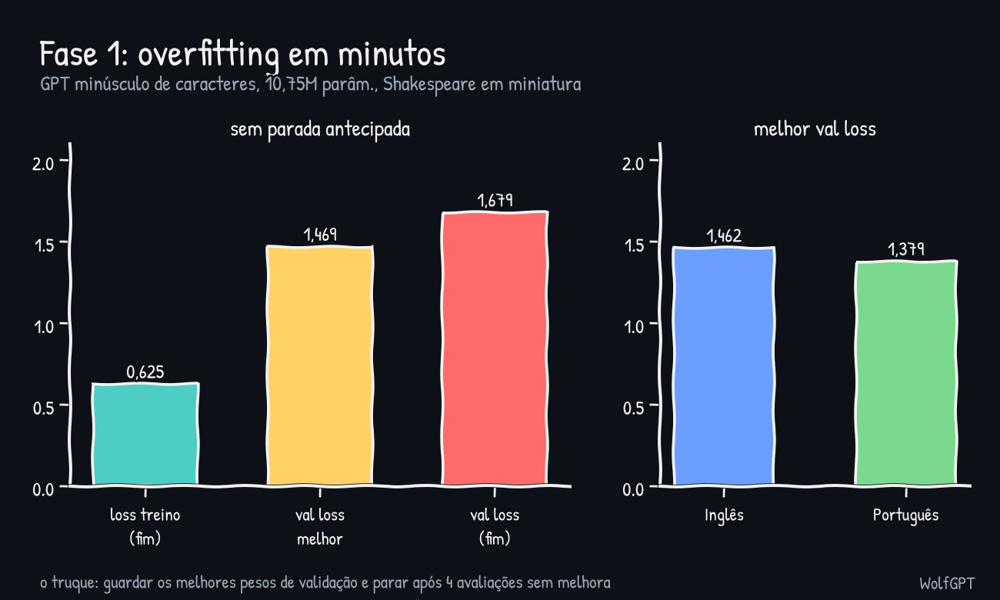

## Fase 2: dados e tokenizer

Só inglês no modelo principal (os textos em português de domínio público usam a ortografia anterior à reforma, então um modelo em português precisa antes de texto moderno). Dados: FineWeb-Edu `sample-10BT`, lido em streaming e dividido pela ordem dos documentos: 100 mil para o tokenizer, 10 mil para validação e o resto para treino.

O tokenizer é um BPE de bytes com 32.768 tokens, treinado em 57 segundos. Ele faz em média 4,61 caracteres por token em texto inédito (o modelo de caracteres da Fase 1 faz 1,00). A tokenização gerou 3.002.016.685 tokens de treino e 10.032.689 de validação, em cerca de 45 minutos a aproximadamente 1,1M tokens/s.

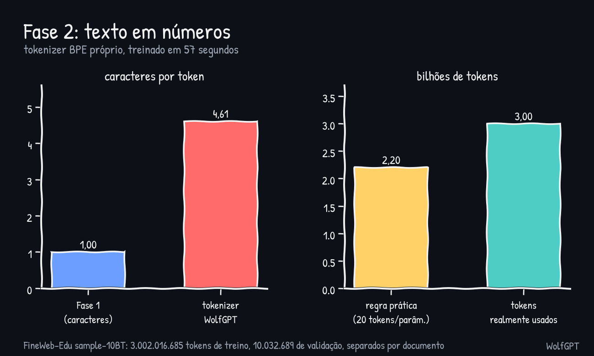

## Fase 3: o piloto, Muon vs AdamW

Um modelo de 47,9M de parâmetros (10 camadas, 8 cabeças, largura 512), 400 passos de 131.072 tokens (52M tokens), mesma ordem de dados e mesmo conjunto fixo de validação em todas as rodadas. Antes do piloto, uma revisão de código independente achou e corrigiu vários erros (veja [PHASE3_FIXES.md](../../phase3/PHASE3_FIXES.md)), então o piloto rodou no código corrigido.

Muon com lr 0,02 chegou a 4,418, Muon com lr 0,05 a 4,537, AdamW com lr 6e-4 a 5,280 e AdamW com lr 2e-3 a 5,352. O Muon ficou 0,86 abaixo (perplexidade cerca de 2,4 vezes menor) com cerca de 4% menos velocidade. Ressalvas: só 52M tokens (a diferença encolhe em treinos longos) e a grade do AdamW teve só dois pontos, com o melhor no extremo mais baixo.

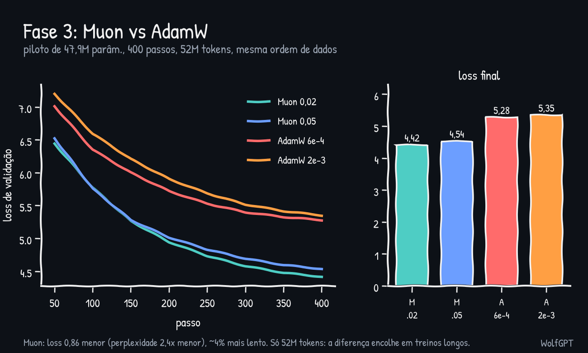

## Fase 4: o treino principal

O modelo: 110.119.680 parâmetros (12 camadas, 12 cabeças, largura 768, contexto 1.024, vocabulário 32.768), com embeddings de entrada e saída compartilhados, RoPE, RMSNorm e feed-forward SwiGLU. Metade dos números está nas camadas feed-forward.

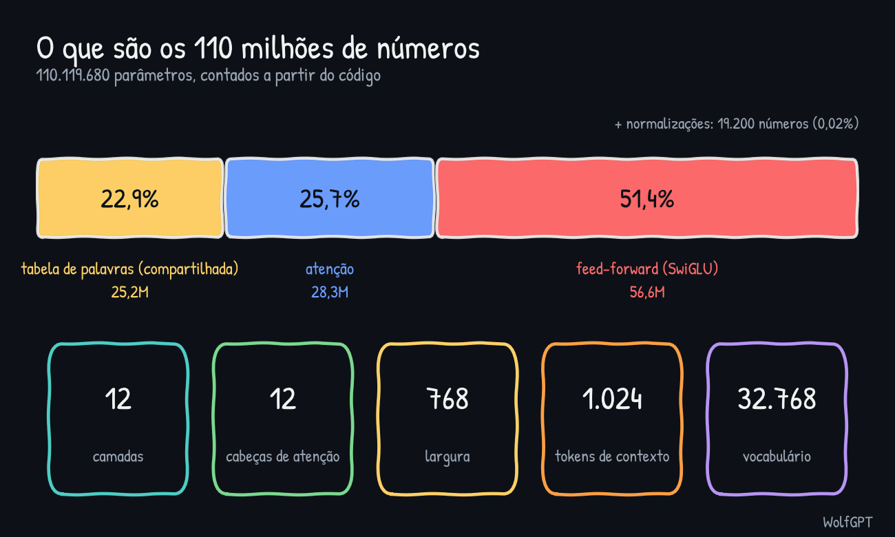

Treino: Muon (lr 0,02) nas matrizes internas mais AdamW (lr 2e-3) nos embeddings e normalizações, 22.888 passos de 131.072 tokens (3,0 bi de tokens, uma única passada embaralhada), bf16, `torch.compile`. Rodou a 46,0 mil tokens/s e 33,0 TFLOP/s, pico de memória 6,5 GB, 18,1 horas. O treino foi parado e retomado pelo menos uma vez, e o código de retomada funcionou.

Loss de validação: 10,57 no passo 0, 4,22 no 500, 3,60 no 2.500, 3,28 no 10.000 e 3,129 no fim (perplexidade cerca de 22,8). A maior norma de gradiente em qualquer avaliação foi 2,28, sem picos. A loss de validação caiu até o último momento, então não houve overfitting.

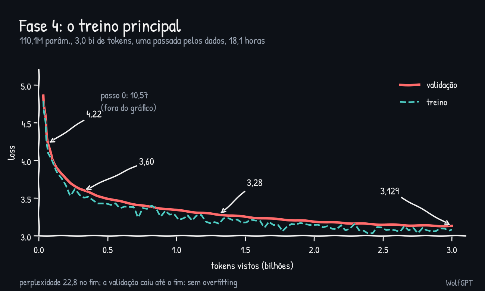

O modelo base é fluente, mas pouco confiável: inventa fatos ("a água ferve a 15 graus"), entra em loop com temperatura baixa e trata "hello" como o começo de um artigo. Isso é esperado com 110M de parâmetros e 3 bi de tokens.

## Fase 5: chat (SFT) e identidade

Dados: smol-smoltalk (cerca de 460 mil chats sintéticos), everyday-conversations (saudações, repetidas 3 vezes só no treino) e Dolly 15k (escrito por humanos), 477.612 conversas no total. Depois de tirar primeiros pedidos repetidos e conversas cuja primeira troca passa de 1.024 tokens, sobraram 446.353 conversas de treino (267,5M tokens, 77% deles de resposta) e 1.000 de validação. A loss é calculada só nos tokens da resposta.

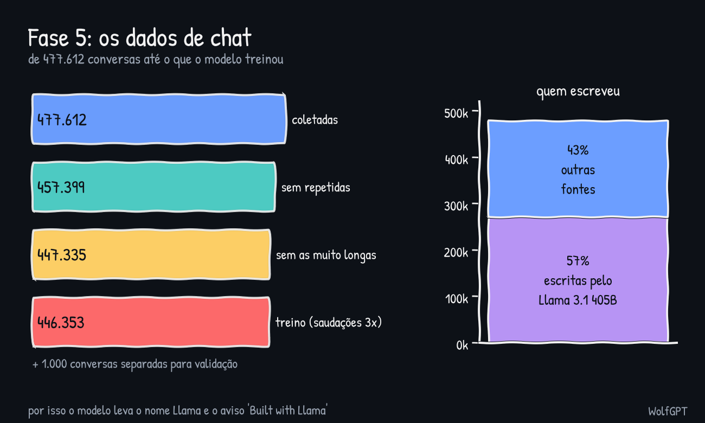

Teste de learning rate (1 época em 150 mil conversas, cerca de 48 minutos cada): 5e-5 deu 1,761, 1e-4 deu 1,706 e 3e-4 deu 1,630 (o modelo base estava em 2,395). A vencedora é o maior valor testado, então uma taxa maior talvez fosse melhor; isso não foi testado.

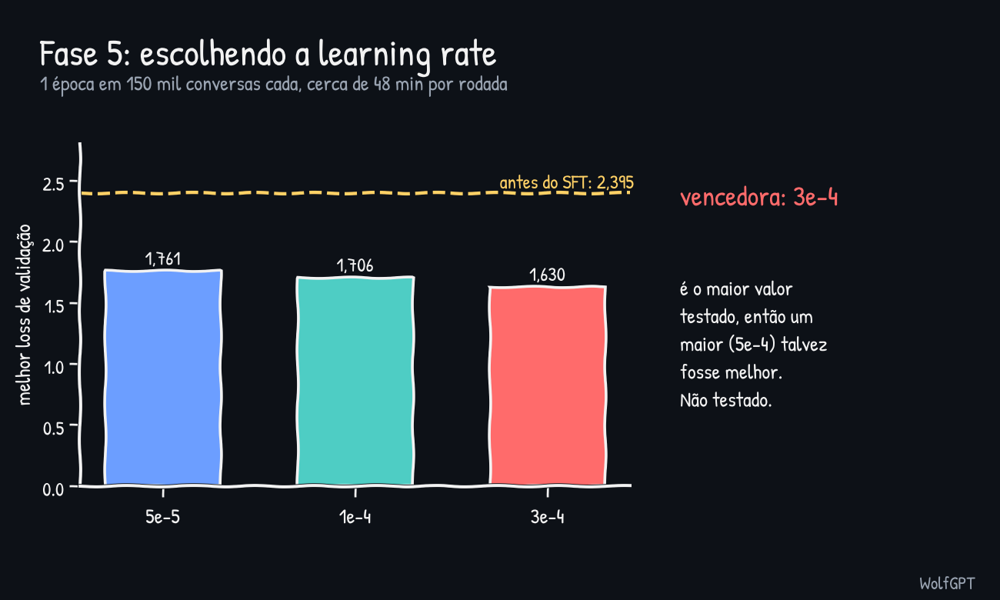

Rodada final: lr 3e-4, 2 épocas, 27.896 passos, 4,6 horas a 33,3 mil tokens/s. Loss de validação de 2,395 para 1,484. A época 1 terminou em 1,541 e a época 2 acrescentou só 0,057. O texto humano do Dolly tem a maior loss entre as fontes e o código a menor.

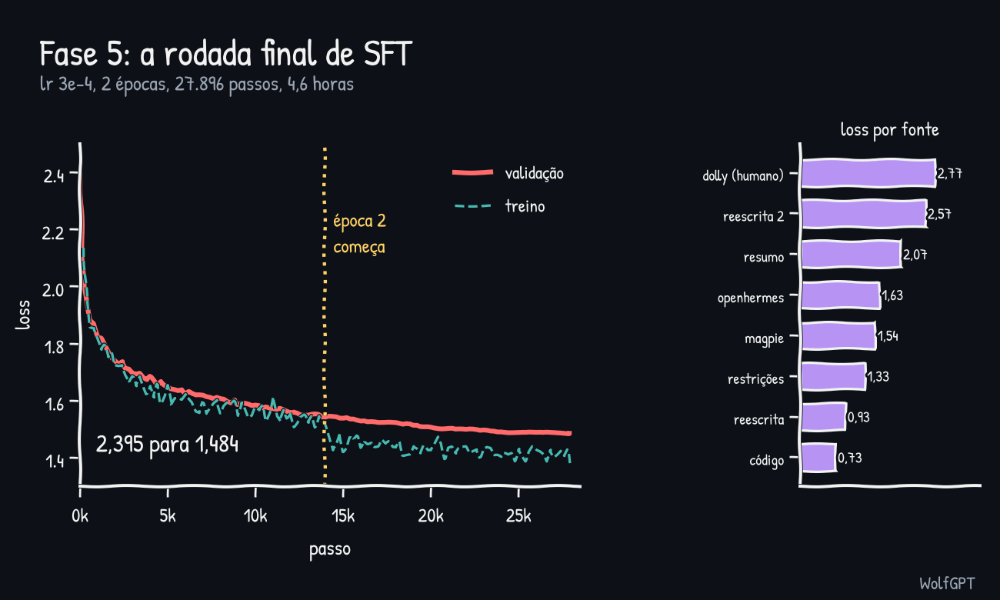

**Identidade.** O modelo não sabia quem era e inventou um pai chamado David. Um agente Haiku escreveu 300 conversas curtas, que foram revisadas (nome WolfGPT, um modelo de linguagem pequeno de cerca de 110M de parâmetros, criado por "Explorer"). A rodada 1 (lr 3e-5, cópias da identidade x3) foi suave demais: loss de identidade de 3,615 para 2,294, nome ainda truncado. A rodada 2 (lr 1e-4, cópias x8) aprendeu o nome mas decorou os chats repetidos: a loss de treino caiu a cerca de 1,0 enquanto a validação de chats comuns subiu de 1,488 para 1,516. O checkpoint de melhor validação (passo 200) era de antes de o nome ser aprendido, então o checkpoint do fim do treino, `wolf2_last.pt`, é o modelo de demonstração.

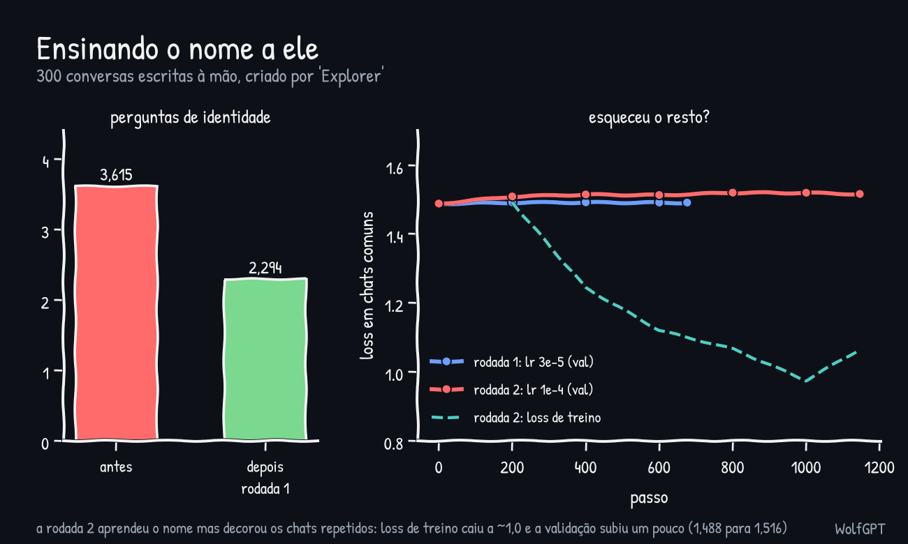

**Correções de repetição na hora do chat** (sem retreinar). Com a fase de identidade, mensagens curtas ("OK") faziam o modelo responder "I understand. I'm WolfGPT..." sem parar. O código do chat agora pontua cada resposta pelas frases repetidas de 4 tokens, rejeita as acima de 0,3 e gera de novo (mais quente, depois com menos memória). Proibir 4-gramas repetidos, em teste offline, levou 112 frases repetidas a 0. Um teste manual com 3 tentativas deu "muito melhor, perfeito" em conversa casual; o que sobra é fraqueza de conteúdo, não loops.

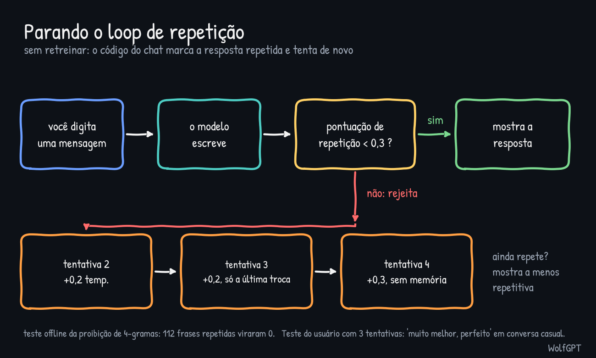

## Fase 6: benchmarks e publicação

Zero-shot, conjuntos de teste completos, pontuando cada resposta pela log-verossimilhança (acurácia normalizada pelo tamanho, exceto no Winogrande). O script foi conferido contra uma referência um-a-um (diferença de 1e-5). O erro padrão vai de cerca de 0,5 (HellaSwag) a 1,4 (Winogrande) pontos.

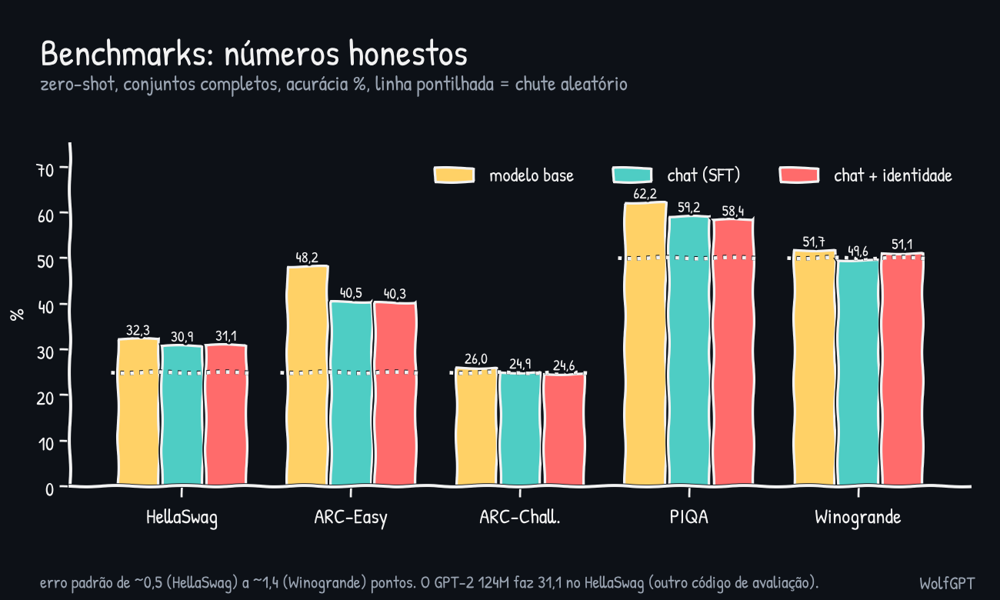

O modelo base fica acima do acaso em HellaSwag, ARC-Easy e PIQA e no acaso em ARC-Challenge e Winogrande. O SFT custa cerca de 8 pontos no ARC-Easy e 3 no PIQA, em parte porque os testes usam texto puro e não o formato de chat. Uma rodada inicial de 100 perguntas mostrou HellaSwag em 44%; era ruído de amostra pequena (o conjunto completo dá 32,3%).

Para onde foi o tempo de GPU, cerca de 26 horas no total:

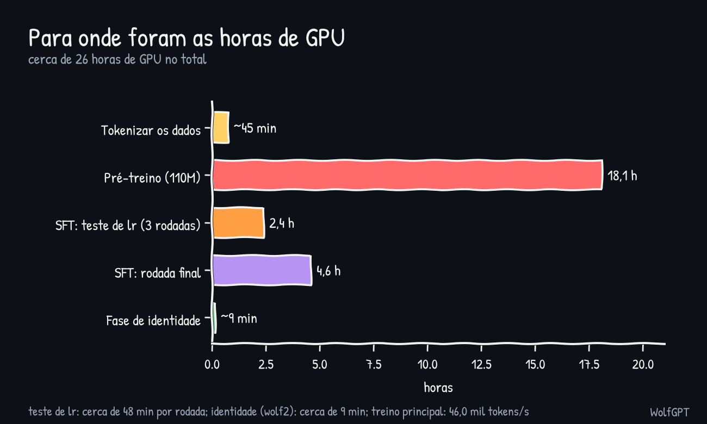

Publicação: o modelo é empacotado como `Llama-WolfGPT-110M` (safetensors, `model.py` e `chat.py` independentes, a licença Llama 3.1, um arquivo NOTICE e um model card com o aviso "Built with Llama"). Cerca de 57% dos dados de chat (270.838 de 477.612 conversas) foram escritos pelo Llama 3.1 405B, então a licença exige o nome Llama e o aviso. Nenhum peso ou código do Llama foi usado. Isto não é aconselhamento jurídico; leia a licença.

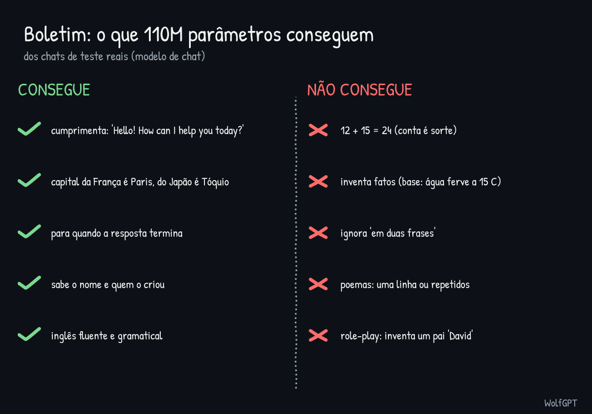

Em seguida: [o que aprendemos](APRENDIZADOS.md) e [as decisões](DECISOES.md).
